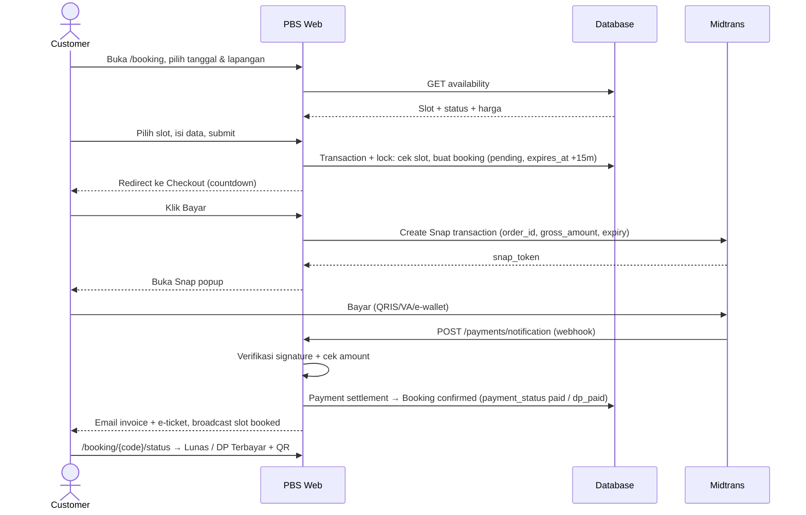
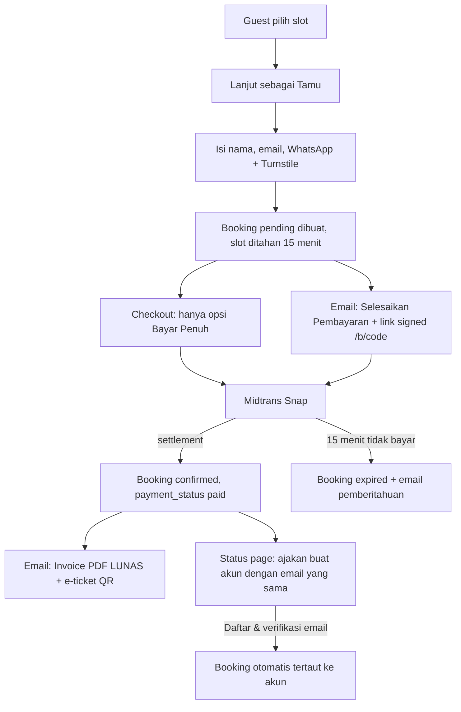
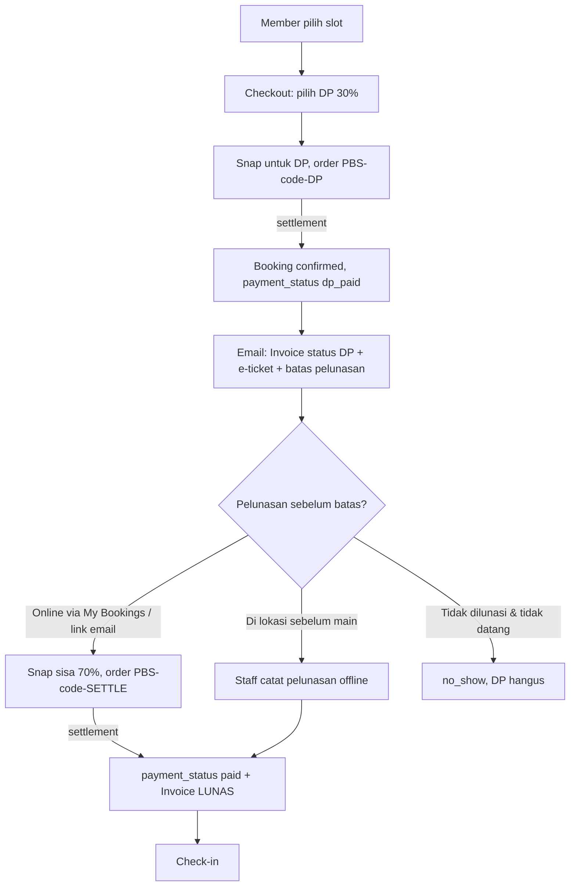
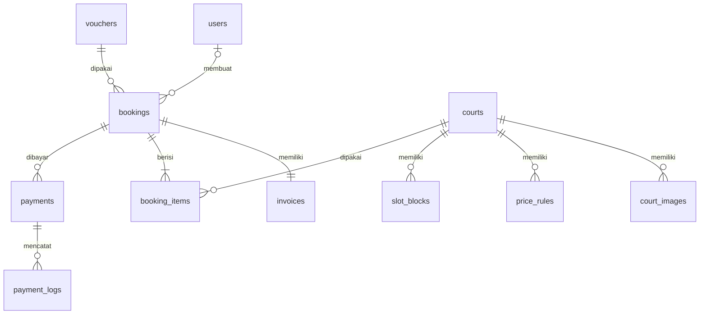

# PRD — PBS (Paddel Booking System)

| Item            | Detail                                                        |
| --------------- | ------------------------------------------------------------- |
| Nama Produk     | PBS — Paddel Booking System                                   |
| Versi Dokumen   | 1.1                                                           |
| Tanggal         | 14 September 2026                                             |
| Status          | Draft                                                         |
| Stack           | Laravel 12 · Inertia.js 2 · React · Tailwind CSS · shadcn/ui · GSAP 3 · Midtrans |

### Riwayat Perubahan

| Versi | Perubahan                                                                                                   |
| ----- | ----------------------------------------------------------------------------------------------------------- |
| 1.0   | Draft awal                                                                                                  |
| 1.1   | Guest checkout (wajib bayar penuh + link bayar & invoice via email), DP 30% khusus member, Midtrans ditetapkan sebagai payment gateway, shadcn/ui sebagai komponen UI |
| Pemilik Dokumen | Azka                                                          |

---

## Daftar Isi

1. [Ringkasan Produk](#1-ringkasan-produk)
2. [Latar Belakang & Masalah](#2-latar-belakang--masalah)
3. [Tujuan & Metrik Keberhasilan](#3-tujuan--metrik-keberhasilan)
4. [Pengguna & Role](#4-pengguna--role)
5. [Ruang Lingkup (Scope)](#5-ruang-lingkup-scope)
6. [Tech Stack & Arsitektur](#6-tech-stack--arsitektur)
7. [Sitemap & Daftar Route](#7-sitemap--daftar-route)
8. [Spesifikasi Halaman](#8-spesifikasi-halaman)
9. [Alur Utama (User Flow)](#9-alur-utama-user-flow)
10. [Aturan Bisnis](#10-aturan-bisnis)
11. [Integrasi Payment Gateway](#11-integrasi-payment-gateway)
12. [Model Data](#12-model-data)
13. [Design System](#13-design-system)
14. [Spesifikasi Animasi GSAP (Homepage)](#14-spesifikasi-animasi-gsap-homepage)
15. [Notifikasi](#15-notifikasi)
16. [Kebutuhan Non-Fungsional](#16-kebutuhan-non-fungsional)
17. [Roadmap & Milestone](#17-roadmap--milestone)
18. [Risiko & Mitigasi](#18-risiko--mitigasi)
19. [Pertanyaan Terbuka](#19-pertanyaan-terbuka)

---

## 1. Ringkasan Produk

PBS adalah aplikasi web untuk memesan lapangan padel secara online. Customer dapat melihat jadwal lapangan yang kosong secara real-time, memilih slot, lalu membayar langsung melalui **Midtrans**. Booking terkonfirmasi otomatis setelah pembayaran berhasil.

PBS mendukung dua cara booking:

| Mode                    | Siapa                     | Pembayaran                                    | Pengiriman                                  |
| ----------------------- | ------------------------- | --------------------------------------------- | ------------------------------------------- |
| **Guest Checkout**      | Tanpa akun                | **Wajib bayar penuh (100%)** saat itu juga    | Link pembayaran, invoice & e-ticket dikirim ke **email** |
| **Member Checkout**     | User terdaftar & login    | Pilih **bayar penuh** atau **DP 30%** (sisa dilunasi sebelum main) | Dashboard My Bookings + email          |

Opsi **DP 30%** adalah keuntungan eksklusif member dan menjadi *selling point* utama agar pengunjung mau mendaftar akun.

Untuk owner/admin, PBS menyediakan dashboard untuk mengelola lapangan, harga, jadwal, booking, dan customer, serta menampilkan analitik okupansi dan pendapatan untuk membantu pengambilan keputusan bisnis.

Homepage dirancang sebagai etalase brand yang premium, elegan, dan catchy dengan animasi berbasis GSAP, bernuansa **hijau & hitam** dengan tipografi **sans-serif**.

---

## 2. Latar Belakang & Masalah

**Masalah customer**
- Harus chat/telepon admin untuk menanyakan jadwal kosong, respons lambat.
- Tidak ada kepastian slot sebelum transfer manual dikonfirmasi.
- Bukti transfer manual rawan salah dan lama diverifikasi.

**Masalah owner**
- Pencatatan booking manual (buku/spreadsheet/chat) rawan double booking.
- Sulit mengetahui jam ramai/sepi, tingkat okupansi, dan pendapatan riil.
- Rekonsiliasi pembayaran memakan waktu.

**Solusi PBS**
- Kalender ketersediaan real-time + pembayaran otomatis via payment gateway.
- Penguncian slot sementara (hold) untuk mencegah double booking.
- Dashboard analitik okupansi, pendapatan, dan customer.

---

## 3. Tujuan & Metrik Keberhasilan

| Tujuan                                   | KPI                                                   | Target (3 bulan setelah launch) |
| ---------------------------------------- | ----------------------------------------------------- | ------------------------------- |
| Mempercepat proses booking               | Waktu dari buka halaman booking → bayar               | < 3 menit                       |
| Menghilangkan double booking             | Jumlah insiden double booking                         | 0                               |
| Guest mau mendaftar akun                 | Guest yang mendaftar setelah booking ÷ total guest    | ≥ 25%                           |
| DP tidak menjadi piutang macet           | Booking DP yang lunas sebelum jam main                | ≥ 90%                           |
| Meningkatkan konversi                    | Booking dibayar ÷ booking dibuat                      | ≥ 70%                           |
| Mengurangi kerja manual admin            | % booking yang dikonfirmasi otomatis                  | ≥ 95%                           |
| Memberi visibilitas bisnis ke owner      | Dashboard dipakai owner                               | ≥ 3x/minggu                     |
| Homepage yang menarik & cepat            | Lighthouse Performance (mobile) / Bounce rate         | ≥ 85 / < 45%                    |

---

## 4. Pengguna & Role

| Role        | Deskripsi                                                     | Akses Utama                                                                 |
| ----------- | ------------------------------------------------------------- | --------------------------------------------------------------------------- |
| **Guest**   | Pengunjung tanpa akun                                         | Homepage, daftar lapangan, cek jadwal, harga, FAQ, kontak, **booking dengan bayar penuh**, akses booking via link email, cek booking (kode + email) |
| **Customer (Member)** | User terdaftar & email terverifikasi                | Booking dengan **bayar penuh atau DP 30%**, pelunasan, riwayat booking, e-ticket, invoice, profil |
| **Staff** *(tambahan)* | Petugas di lokasi (resepsionis)                     | Lihat jadwal hari ini, check-in customer, booking walk-in                    |
| **Owner/Admin** | Pemilik venue                                             | Semua fitur admin: lapangan, harga, jadwal, booking, customer, laporan, pengaturan |

> Role disimpan pada kolom `role` di tabel `users` (`customer`, `staff`, `admin`) dan dilindungi middleware `role:*` + Laravel Policy.

### Persona

- **Rina (28, karyawan)** — main padel 2x seminggu sepulang kerja. Ingin cepat lihat slot kosong jam 19.00–21.00 dan bayar via QRIS/e-wallet dari HP. Sebagai member, ia sering booking seminggu sebelumnya dengan DP 30% agar slot favoritnya aman.
- **Andre (31, pemain baru)** — diajak teman, baru pertama kali main. Tidak mau repot bikin akun; cukup isi nama, email, no. WhatsApp, bayar penuh, lalu terima invoice & e-ticket di email.
- **Pak Budi (45, owner)** — punya 4 lapangan. Ingin tahu jam mana yang sepi untuk bikin promo, dan berapa pendapatan bulan ini tanpa buka spreadsheet.
- **Dimas (22, staff)** — jaga resepsionis. Perlu scan/verifikasi kode booking dan input booking walk-in.

---

## 5. Ruang Lingkup (Scope)

### 5.1 MVP (Fase 1)

**Customer**
- Registrasi, login, verifikasi email, lupa password (Laravel Breeze).
- Login dengan Google *(opsional, direkomendasikan)*.
- Lihat daftar & detail lapangan.
- Kalender ketersediaan slot per lapangan per tanggal (real-time).
- Booking multi-slot (beberapa jam berurutan) dalam satu transaksi.
- **Guest checkout:** booking tanpa akun (nama, email, no. WhatsApp), wajib bayar penuh; link pembayaran, invoice, dan e-ticket dikirim ke email.
- **Member checkout:** pilihan bayar penuh atau **DP 30%**, dengan pelunasan online sebelum jam main.
- Pembayaran online via **Midtrans Snap** (QRIS, GoPay, ShopeePay, VA bank, kartu).
- **Invoice** (nomor invoice, rincian, status) dikirim via email + dapat diunduh PDF.
- Halaman status pembayaran (lunas / DP terbayar / pending / gagal / kedaluwarsa).
- Cek booking untuk guest (kode booking + email → kirim ulang link).
- Guest dapat membuat akun setelah booking; booking dengan email yang sama otomatis tertaut ke akunnya.
- Riwayat booking + detail booking + e-ticket dengan QR code (member).
- Pembatalan booking sesuai kebijakan.
- Profil: ubah data diri, nomor WhatsApp, password, hapus akun.

**Admin/Owner**
- Dashboard analitik (pendapatan, okupansi, jumlah booking, jam ramai, customer baru).
- CRUD lapangan (nama, tipe indoor/outdoor, foto, fasilitas, status aktif).
- Pengaturan harga per lapangan (harga dasar, peak/off-peak, weekday/weekend).
- Jam operasional & durasi slot.
- Blokir slot (maintenance, event, turnamen).
- Manajemen booking (lihat, filter, detail, batalkan, tandai check-in, booking manual/walk-in).
- Daftar customer + detail customer (riwayat & total transaksi).
- Daftar transaksi pembayaran & status (DP, pelunasan, bayar penuh).
- Daftar sisa tagihan (booking DP yang belum lunas) + pencatatan pelunasan di lokasi.
- Export laporan (CSV/Excel).

### 5.2 Fase 2 (Setelah MVP)
- Voucher/kode promo & diskon jam sepi.
- Membership / paket (mis. 10x main).
- Refund otomatis via API payment gateway.
- Notifikasi WhatsApp (pengingat H-1 dan 1 jam sebelum main).
- Split bill antar pemain.
- Rating & ulasan lapangan.
- Sewa raket/bola (add-on) saat booking.
- Multi-venue (satu owner, beberapa lokasi).
- PWA (installable di HP).

### 5.3 Di Luar Scope
- Aplikasi mobile native (iOS/Android).
- Sistem matchmaking / cari lawan main.
- Point of Sale kantin.

---

## 6. Tech Stack & Arsitektur

| Layer              | Teknologi                                                                   |
| ------------------ | --------------------------------------------------------------------------- |
| Backend            | Laravel 12 (PHP 8.2+)                                                       |
| Frontend           | Inertia.js 2 + React (saat ini 18 dari Breeze → upgrade ke 19 untuk shadcn) |
| Routing di JS      | Ziggy (`route()` helper)                                                    |
| Styling            | Tailwind CSS v4 (`@tailwindcss/vite`)                                       |
| Komponen UI        | **shadcn/ui** (Radix UI + Tailwind) — detail di §13.4                       |
| Ikon               | lucide-react (default shadcn)                                               |
| Validasi form (client) | zod (opsional, validasi utama tetap di Laravel Form Request)            |
| Animasi            | **GSAP 3** + ScrollTrigger, SplitText, ScrollSmoother, Flip, `@gsap/react` (`useGSAP`) |
| Smooth scroll      | GSAP ScrollSmoother *(atau Lenis sebagai alternatif)*                       |
| Chart (admin)      | shadcn Charts (berbasis Recharts)                                           |
| Tabel data (admin) | shadcn Data Table (TanStack Table)                                          |
| Invoice PDF        | `barryvdh/laravel-dompdf`                                                   |
| Anti-spam guest    | Cloudflare Turnstile + rate limiting                                        |
| Tanggal            | dayjs (locale `id`, timezone `Asia/Jakarta`)                                |
| Database           | SQLite (development) → **MySQL 8 / PostgreSQL** (production)                |
| Queue & Scheduler  | Laravel Queue (database/Redis) + Task Scheduler                             |
| Payment Gateway    | **Midtrans** (Snap + Notification Webhook + Status API) — keputusan final   |
| Real-time          | Laravel Reverb (broadcast perubahan slot) — fallback polling 15 detik       |
| Email              | Laravel Mail (SMTP/Resend/Mailgun)                                          |
| QR Code            | `simplesoftwareio/simple-qrcode` (server) atau `qrcode.react` (client)      |
| Export             | `maatwebsite/excel`                                                         |
| Storage gambar     | Laravel Storage (local → S3/R2 di production)                               |
| Testing            | PHPUnit (Feature test booking & webhook)                                    |

> **Catatan teknis:** di `package.json` saat ini terpasang `tailwindcss@^3` sekaligus `@tailwindcss/vite@^4`, dan React 18. Karena shadcn/ui versi terbaru dibangun untuk **Tailwind v4 + React 19**, disarankan pada Sprint 0:
> 1. Upgrade ke React 19 (`@inertiajs/react` v2 sudah mendukung) dan migrasi penuh ke Tailwind v4 (hapus `tailwind.config.js`/`postcss.config.js`, konfigurasi via CSS `@theme`).
> 2. Jalankan `npx shadcn@latest init` dengan `"tsx": false` (proyek memakai `.jsx`).
> 3. Ganti komponen bawaan Breeze (`resources/js/Components/*`) dan Headless UI dengan komponen shadcn secara bertahap.
>
> Alternatif jika tetap di Tailwind v3 + React 18: gunakan CLI lama `npx shadcn@2.3.0 init`.

### Arsitektur Tingkat Tinggi

```
Browser (React + Inertia + GSAP)
        │  Inertia requests / JSON (availability)
        ▼
Laravel 12 ── Controllers per fitur (memanggil Eloquent Model langsung; logika bisnis di method/scope model)
   │                │
   │                ├── Eloquent Models ── MySQL/PostgreSQL
   │                ├── Queue Jobs (email, expire booking)
   │                └── Events → Reverb (slot updated)
   │
   └── Webhook /payments/notification  ◄── Midtrans
```

---

## 7. Sitemap & Daftar Route

### 7.1 Sitemap

```
PBS
├── Public
│   ├── /                         Homepage
│   ├── /courts                   Daftar Lapangan
│   ├── /courts/{slug}            Detail Lapangan
│   ├── /schedule                 Jadwal Ketersediaan
│   ├── /pricing                  Harga
│   ├── /about                    Tentang Kami
│   ├── /contact                  Kontak & Lokasi
│   ├── /faq                      FAQ
│   ├── /terms                    Syarat & Ketentuan
│   ├── /privacy                  Kebijakan Privasi
│   └── /membership               Keuntungan Member (DP 30%, dll.)
│
├── Booking (Guest & Member)
│   ├── /booking                  Booking Form
│   ├── /booking/checkout/{code}  Checkout / Pilih Pembayaran
│   ├── /booking/{code}/status    Status Pembayaran
│   ├── /booking/lookup           Cek Booking (guest: kode + email)
│   ├── /b/{code}?signature=…     Akses Booking Guest (link dari email)
│   └── /invoices/{number}        Invoice (signed URL / pemilik)
│
├── Auth
│   ├── /login  /register  /forgot-password  /reset-password/{token}
│   ├── /verify-email  /confirm-password
│   └── /auth/google (+ callback)
│
├── Customer (login)
│   ├── /my-bookings              Riwayat Booking
│   ├── /my-bookings/{code}/settle  Pelunasan DP
│   ├── /my-invoices              Daftar Invoice
│   ├── /my-bookings/{code}       Detail Booking + E-Ticket
│   └── /profile                  Profil
│
├── Staff (login + role staff/admin)
│   ├── /staff                    Jadwal Hari Ini
│   └── /staff/check-in           Check-in (scan QR / input kode)
│
└── Admin (login + role admin)
    ├── /admin                    Dashboard
    ├── /admin/courts             Lapangan & Harga
    ├── /admin/schedule           Kalender Jadwal & Blokir Slot
    ├── /admin/bookings           Manajemen Booking
    ├── /admin/customers          Daftar Customer
    ├── /admin/payments           Transaksi
    ├── /admin/receivables        Sisa Tagihan (DP belum lunas)
    ├── /admin/invoices           Invoice
    ├── /admin/reports            Laporan
    ├── /admin/vouchers           Voucher (Fase 2)
    ├── /admin/users              Staff & Admin
    └── /admin/settings           Pengaturan Venue
```

### 7.2 Tabel Route Lengkap

Keterangan kolom **Fase**: `MVP` = wajib di Fase 1, `F2` = Fase 2. Halaman yang Anda minta ditandai ⭐, sisanya adalah tambahan yang dibutuhkan untuk menunjang sistem.

#### A. Public (Guest)

| Method | URI                  | Route Name        | Controller@method              | Inertia Page             | Fase |
| ------ | -------------------- | ----------------- | ------------------------------ | ------------------------ | ---- |
| GET    | `/`                  | `home`            | `HomeController@index`         | `Home`  ⭐               | MVP  |
| GET    | `/courts`            | `courts.index`    | `CourtController@index`        | `Courts/Index`           | MVP  |
| GET    | `/courts/{court:slug}` | `courts.show`   | `CourtController@show`         | `Courts/Show`            | MVP  |
| GET    | `/schedule`          | `schedule.index`  | `ScheduleController@index`     | `Schedule/Index`         | MVP  |
| GET    | `/pricing`           | `pricing`         | `PageController@pricing`       | `Pricing`                | MVP  |
| GET    | `/about`             | `about`           | `PageController@about`         | `About`                  | MVP  |
| GET    | `/contact`           | `contact`         | `PageController@contact`       | `Contact`                | MVP  |
| POST   | `/contact`           | `contact.send`    | `PageController@sendContact`   | —                        | F2   |
| GET    | `/faq`               | `faq`             | `PageController@faq`           | `Faq`                    | MVP  |
| GET    | `/terms`             | `terms`           | `PageController@terms`         | `Legal/Terms`            | MVP  |
| GET    | `/privacy`           | `privacy`         | `PageController@privacy`       | `Legal/Privacy`          | MVP  |
| GET    | `/membership`        | `membership`      | `PageController@membership`    | `Membership`             | MVP  |

#### A2. Booking — Guest & Member (tanpa middleware `auth`; guest dilindungi Turnstile + rate limit)

| Method | URI                                   | Route Name              | Controller@method                  | Inertia Page             | Fase |
| ------ | ------------------------------------- | ----------------------- | ---------------------------------- | ------------------------ | ---- |
| GET    | `/booking`                            | `booking.create`        | `BookingController@create`         | `Booking/Create` ⭐      | MVP  |
| POST   | `/booking`                            | `booking.store`         | `BookingController@store`          | — (buat hold → redirect checkout) | MVP |
| GET    | `/booking/checkout/{booking:code}`    | `booking.checkout`      | `BookingController@checkout`       | `Booking/Checkout`       | MVP  |
| POST   | `/booking/{booking:code}/pay`         | `booking.pay`           | `PaymentController@create`         | — (return Snap token; body `payment_type`: `full`/`dp`) | MVP |
| GET    | `/booking/{booking:code}/status`      | `booking.status`        | `PaymentController@status`         | `Booking/Status`         | MVP  |
| GET    | `/booking/lookup`                     | `booking.lookup`        | `BookingLookupController@show`     | `Booking/Lookup`         | MVP  |
| POST   | `/booking/lookup`                     | `booking.lookup.send`   | `BookingLookupController@send`     | — (kirim ulang link ke email terdaftar) | MVP |
| GET    | `/b/{booking:code}`                   | `booking.guest.show`    | `GuestBookingController@show`      | `Booking/GuestShow` (middleware `signed`) | MVP |
| POST   | `/b/{booking:code}/pay`               | `booking.guest.pay`     | `GuestBookingController@pay`       | — (middleware `signed`; buat Snap baru jika belum expired) | MVP |
| GET    | `/invoices/{invoice:number}`          | `invoices.show`         | `InvoiceController@show`           | `Invoices/Show` (signed atau pemilik) | MVP |
| GET    | `/invoices/{invoice:number}/pdf`      | `invoices.pdf`          | `InvoiceController@pdf`            | — (unduh PDF)            | MVP  |

> Akses booking & invoice guest menggunakan **signed URL** Laravel (`URL::signedRoute`) sehingga tidak bisa ditebak. Checkout/status untuk booking guest juga memvalidasi token sesi atau signature; booking milik member hanya dapat diakses pemiliknya (Policy).

#### B. Auth (sebagian besar sudah tersedia dari Breeze di `routes/auth.php`)

| Method   | URI                               | Route Name              | Inertia Page             | Fase |
| -------- | --------------------------------- | ----------------------- | ------------------------ | ---- |
| GET/POST | `/register`                       | `register`              | `Auth/Register`          | MVP  |
| GET/POST | `/login`                          | `login`                 | `Auth/Login`             | MVP  |
| POST     | `/logout`                         | `logout`                | —                        | MVP  |
| GET/POST | `/forgot-password`                | `password.request` / `password.email` | `Auth/ForgotPassword` | MVP |
| GET/POST | `/reset-password/{token}`         | `password.reset` / `password.store`   | `Auth/ResetPassword`  | MVP |
| GET      | `/verify-email`                   | `verification.notice`   | `Auth/VerifyEmail`       | MVP  |
| GET      | `/verify-email/{id}/{hash}`       | `verification.verify`   | —                        | MVP  |
| GET/POST | `/confirm-password`               | `password.confirm`      | `Auth/ConfirmPassword`   | MVP  |
| GET      | `/auth/google/redirect`           | `auth.google`           | —                        | F2   |
| GET      | `/auth/google/callback`           | `auth.google.callback`  | —                        | F2   |

#### C. Customer (middleware: `auth`, `verified`)

| Method | URI                                  | Route Name              | Controller@method                  | Inertia Page             | Fase |
| ------ | ------------------------------------ | ----------------------- | ---------------------------------- | ------------------------ | ---- |
| GET    | `/my-bookings`                       | `my-bookings.index`     | `MyBookingController@index`        | `MyBookings/Index`       | MVP  |
| POST   | `/my-bookings/{booking:code}/settle` | `my-bookings.settle`    | `SettlementController@store`       | — (Snap token untuk sisa 70%) | MVP |
| GET    | `/my-bookings/claim`                 | `my-bookings.claim`     | `ClaimBookingController`           | — (tautkan booking guest ber-email sama setelah verifikasi) | MVP |
| GET    | `/my-bookings/{booking:code}`        | `my-bookings.show`      | `MyBookingController@show`         | `MyBookings/Show`        | MVP  |
| POST   | `/my-bookings/{booking:code}/cancel` | `my-bookings.cancel`    | `MyBookingController@cancel`       | —                        | MVP  |
| GET    | `/my-bookings/{booking:code}/ticket` | `my-bookings.ticket`    | `MyBookingController@ticket`       | — (PDF e-ticket)         | F2   |
| GET    | `/my-invoices`                       | `my-invoices.index`     | `InvoiceController@index`          | `Invoices/Index`         | MVP  |
| GET    | `/profile`                           | `profile.edit`          | `ProfileController@edit`           | `Profile/Edit` ⭐        | MVP  |
| PATCH  | `/profile`                           | `profile.update`        | `ProfileController@update`         | —                        | MVP  |
| PUT    | `/password`                          | `password.update`       | `PasswordController@update`        | —                        | MVP  |
| DELETE | `/profile`                           | `profile.destroy`       | `ProfileController@destroy`        | —                        | MVP  |

> Route `/dashboard` bawaan Breeze diubah: setelah login, **customer** diarahkan ke `/my-bookings`, **admin** ke `/admin`, **staff** ke `/staff`.

#### D. Staff (middleware: `auth`, `role:staff,admin`, prefix `/staff`, name `staff.`)

| Method | URI                              | Route Name              | Inertia Page             | Fase |
| ------ | -------------------------------- | ----------------------- | ------------------------ | ---- |
| GET    | `/staff`                         | `staff.today`           | `Staff/Today`            | MVP  |
| GET    | `/staff/check-in`                | `staff.check-in`        | `Staff/CheckIn`          | MVP  |
| POST   | `/staff/check-in`                | `staff.check-in.store`  | —                        | MVP  |
| POST   | `/staff/bookings/{booking}/settle-offline` | `staff.settle-offline` | — (catat pelunasan tunai/QRIS venue) | MVP |

#### E. Admin (middleware: `auth`, `role:admin`, prefix `/admin`, name `admin.`)

| Method    | URI                                        | Route Name                     | Inertia Page                 | Fase |
| --------- | ------------------------------------------ | ------------------------------ | ---------------------------- | ---- |
| GET       | `/admin`                                   | `admin.dashboard`              | `Admin/Dashboard` ⭐         | MVP  |
| GET       | `/admin/courts`                            | `admin.courts.index`           | `Admin/Courts/Index` ⭐      | MVP  |
| GET       | `/admin/courts/create`                     | `admin.courts.create`          | `Admin/Courts/Form`          | MVP  |
| POST      | `/admin/courts`                            | `admin.courts.store`           | —                            | MVP  |
| GET       | `/admin/courts/{court}/edit`               | `admin.courts.edit`            | `Admin/Courts/Form`          | MVP  |
| PUT       | `/admin/courts/{court}`                    | `admin.courts.update`          | —                            | MVP  |
| DELETE    | `/admin/courts/{court}`                    | `admin.courts.destroy`         | — (soft delete)              | MVP  |
| PATCH     | `/admin/courts/{court}/toggle`             | `admin.courts.toggle`          | — (aktif/nonaktif)           | MVP  |
| GET       | `/admin/courts/{court}/pricing`            | `admin.courts.pricing`         | `Admin/Courts/Pricing` ⭐    | MVP  |
| PUT       | `/admin/courts/{court}/pricing`            | `admin.courts.pricing.update`  | —                            | MVP  |
| GET       | `/admin/schedule`                          | `admin.schedule.index`         | `Admin/Schedule/Index`       | MVP  |
| POST      | `/admin/schedule/blocks`                   | `admin.schedule.blocks.store`  | —                            | MVP  |
| DELETE    | `/admin/schedule/blocks/{block}`           | `admin.schedule.blocks.destroy`| —                            | MVP  |
| GET       | `/admin/bookings`                          | `admin.bookings.index`         | `Admin/Bookings/Index`       | MVP  |
| GET       | `/admin/bookings/create`                   | `admin.bookings.create`        | `Admin/Bookings/Create`      | MVP  |
| POST      | `/admin/bookings`                          | `admin.bookings.store`         | — (walk-in / manual)         | MVP  |
| GET       | `/admin/bookings/{booking}`                | `admin.bookings.show`          | `Admin/Bookings/Show`        | MVP  |
| POST      | `/admin/bookings/{booking}/cancel`         | `admin.bookings.cancel`        | —                            | MVP  |
| POST      | `/admin/bookings/{booking}/check-in`       | `admin.bookings.check-in`      | —                            | MVP  |
| GET       | `/admin/customers`                         | `admin.customers.index`        | `Admin/Customers/Index` ⭐   | MVP  |
| GET       | `/admin/customers/{user}`                  | `admin.customers.show`         | `Admin/Customers/Show`       | MVP  |
| PATCH     | `/admin/customers/{user}/block`            | `admin.customers.block`        | —                            | MVP  |
| GET       | `/admin/payments`                          | `admin.payments.index`         | `Admin/Payments/Index`       | MVP  |
| GET       | `/admin/payments/{payment}`                | `admin.payments.show`          | `Admin/Payments/Show`        | MVP  |
| GET       | `/admin/receivables`                       | `admin.receivables.index`      | `Admin/Receivables/Index` (booking DP belum lunas) | MVP |
| POST      | `/admin/bookings/{booking}/remind`         | `admin.bookings.remind`        | — (kirim ulang tagihan pelunasan) | MVP |
| GET       | `/admin/invoices`                          | `admin.invoices.index`         | `Admin/Invoices/Index`       | MVP  |
| GET       | `/admin/reports`                           | `admin.reports.index`          | `Admin/Reports/Index`        | MVP  |
| GET       | `/admin/reports/export`                    | `admin.reports.export`         | — (CSV/XLSX)                 | MVP  |
| RESOURCE  | `/admin/vouchers`                          | `admin.vouchers.*`             | `Admin/Vouchers/*`           | F2   |
| RESOURCE  | `/admin/users`                             | `admin.users.*`                | `Admin/Users/*`              | MVP  |
| GET       | `/admin/settings`                          | `admin.settings.edit`          | `Admin/Settings`             | MVP  |
| PUT       | `/admin/settings`                          | `admin.settings.update`        | —                            | MVP  |

#### F. API internal & Webhook

| Method | URI                                   | Route Name                 | Keterangan                                                        | Fase |
| ------ | ------------------------------------- | -------------------------- | ----------------------------------------------------------------- | ---- |
| GET    | `/api/availability`                   | `api.availability`         | Query `court_id`, `date` → daftar slot + status + harga           | MVP  |
| POST   | `/api/pricing/quote`                  | `api.pricing.quote`        | Hitung total harga untuk slot yang dipilih (dan voucher)          | MVP  |
| GET    | `/admin/api/stats`                    | `admin.api.stats`          | Data chart dashboard berdasarkan rentang tanggal                  | MVP  |
| POST   | `/payments/notification`              | `payments.notification`    | **Webhook Midtrans** — dikecualikan dari CSRF, verifikasi signature | MVP  |
| GET    | `/payments/finish`                    | `payments.finish`          | Redirect URL setelah Snap selesai → ke `booking.status`           | MVP  |
| GET    | `/payments/unfinish` · `/payments/error` | `payments.unfinish` · `payments.error` | Redirect Snap saat user menutup / gagal bayar            | MVP  |

#### G. Halaman Sistem

| Kondisi         | Inertia Page    |
| --------------- | --------------- |
| 403 Forbidden   | `Errors/403`    |
| 404 Not Found   | `Errors/404`    |
| 419 Page Expired| `Errors/419`    |
| 500 Server Error| `Errors/500`    |
| 503 Maintenance | `Errors/503`    |

---

## 8. Spesifikasi Halaman

### 8.1 Homepage `/` ⭐

**Tujuan:** memikat pengunjung, membangun kesan premium, dan mengarahkan ke booking secepat mungkin.

**Section (urutan dari atas):**

| # | Section               | Konten                                                                                           | Animasi (detail di §14)                 |
| - | --------------------- | ------------------------------------------------------------------------------------------------ | --------------------------------------- |
| 0 | Preloader             | Logo PBS + counter 0→100%                                                                        | Counter + curtain reveal                |
| 1 | Navbar                | Logo, menu (Courts, Schedule, Pricing, About), tombol **Book Now**, Login                        | Hide on scroll down, show on scroll up  |
| 2 | Hero                  | Headline besar (mis. *"Own The Court."*), subheadline, CTA **Book a Court** & **Cek Jadwal**, video/visual lapangan | SplitText reveal, parallax visual, magnetic CTA |
| 3 | Quick Availability    | Widget mini: pilih tanggal → tampil jumlah slot kosong per lapangan hari itu + CTA               | Stagger fade-up                         |
| 4 | Marquee               | Teks berjalan: *PADEL • BOOK • PLAY • REPEAT*                                                    | Infinite marquee, kecepatan ikut scroll |
| 5 | Stats                 | Jumlah lapangan, jam operasional, total pemain, rating                                           | Number counter saat masuk viewport      |
| 6 | Courts Showcase       | Kartu lapangan (foto, tipe, harga mulai dari) dalam scroll horizontal                            | Pinned horizontal scroll                |
| 7 | How It Works          | 3 langkah: Pilih Jadwal → Bayar → Main                                                           | Pinned section, step ter-highlight + garis progress (DrawSVG) |
| 8 | Features / Why PBS    | Real-time schedule, instant payment, e-ticket QR, lapangan premium                               | Card stagger + hover tilt               |
| 9 | Pricing Preview       | Off-peak vs Peak vs Weekend                                                                      | Flip / scale-in                         |
| 9b| **Member Benefits**   | Perbandingan **Guest vs Member**: *"Amankan slot cukup dengan DP 30%"*, riwayat booking, invoice tersimpan, checkout lebih cepat, promo member (F2). CTA **Daftar Gratis** | Kartu Member membesar & glow hijau, angka "30%" counter + SplitText |
| 10| Gallery               | Foto/video suasana                                                                               | Image reveal (clip-path) + parallax     |
| 11| Testimonials          | Ulasan customer                                                                                  | Slider auto dengan drag                 |
| 12| FAQ singkat           | 4–6 pertanyaan teratas                                                                           | Accordion height tween                  |
| 13| Final CTA             | *"Your next game starts here."* + tombol Book Now                                               | Background zoom + text scrub            |
| 14| Footer                | Alamat, Google Maps, jam buka, sosial media, link legal                                          | Big logo reveal                         |

**Kriteria penerimaan:**
- CTA "Book Now" terlihat tanpa scroll (above the fold) di desktop & mobile.
- LCP < 2.5 detik di koneksi 4G; animasi tidak menghalangi interaksi.
- `prefers-reduced-motion` dihormati (animasi diganti fade sederhana).
- Data lapangan & harga diambil dari database (bukan hardcode).

### 8.2 Daftar Lapangan `/courts`
- Grid kartu lapangan: foto, nama, tipe (indoor/outdoor), fasilitas, harga mulai dari, badge "X slot tersedia hari ini".
- Filter: tipe lapangan, tanggal.
- CTA per kartu → `booking.create?court={id}`.

### 8.3 Detail Lapangan `/courts/{slug}`
- Galeri foto, deskripsi, fasilitas, aturan pakai.
- Tabel harga per jam (weekday/weekend, peak/off-peak).
- Mini kalender ketersediaan 7 hari ke depan.
- CTA **Book This Court**.

### 8.4 Jadwal `/schedule`
- Grid: baris = jam, kolom = lapangan, untuk tanggal terpilih.
- Warna status: **Tersedia** (hijau), **Dipesan** (abu gelap), **Ditahan/pending** (hijau redup bergaris), **Diblokir** (merah redup), **Lewat** (disabled).
- Guest bisa melihat & langsung booking; klik slot tersedia → booking form terisi otomatis (tanpa wajib login).
- Update otomatis (Reverb / polling).

### 8.5 Booking Form `/booking` ⭐
**Langkah (stepper):**
1. **Pilih tanggal** — date picker horizontal 14 hari ke depan (batas diatur di settings).
2. **Pilih lapangan** — kartu lapangan dengan jumlah slot kosong.
3. **Pilih slot** — grid jam; bisa pilih beberapa slot **berurutan**; harga tiap slot tampil.
4. **Data pemesan**
   - **Member (login):** nama, email, no. WhatsApp otomatis terisi dari profil.
   - **Guest:** tampil pilihan dua kartu — **"Masuk / Daftar"** (dengan highlight *"Bisa bayar DP 30%"*) atau **"Lanjut sebagai Tamu"**. Jika lanjut sebagai tamu: isi nama lengkap, **email (wajib, untuk link bayar & invoice)**, konfirmasi email, no. WhatsApp, lalu verifikasi Turnstile.
   - Semua: jumlah pemain (2–4), catatan.
5. **Ringkasan** — lapangan, tanggal, jam, subtotal, biaya layanan (jika ada), voucher (F2), total.
6. Setuju S&K → **Lanjut ke Pembayaran**.

**Kriteria penerimaan:**
- Guest dapat menyelesaikan booking tanpa membuat akun.
- Jika guest memilih "Masuk / Daftar", pilihan slot & data form tidak hilang (disimpan di session, dilanjutkan setelah login/registrasi).
- Email guest divalidasi format & domain (DNS); ditampilkan ulang di ringkasan agar tidak salah ketik.
- Slot yang sudah dipesan/ditahan/diblokir/lewat tidak bisa dipilih.
- Harga dihitung ulang di server (`Court::priceAt()`), bukan dipercaya dari client.
- Jika slot direbut orang lain saat submit → pesan error jelas + grid di-refresh.
- Sticky summary bar di mobile.

### 8.6 Checkout & Pembayaran `/booking/checkout/{code}`
- Ringkasan booking + **countdown timer** batas bayar (default 15 menit).
- **Pilihan metode pembayaran (RadioGroup):**

  | Opsi                 | Guest                                                                 | Member                                  |
  | -------------------- | --------------------------------------------------------------------- | --------------------------------------- |
  | **Bayar Penuh (100%)** | ✅ Satu-satunya opsi                                                 | ✅ Tersedia                              |
  | **DP 30%**           | 🔒 Terkunci, tampil label *"Khusus member — Daftar gratis untuk bayar DP Rp105.000 saja"* + tombol Daftar | ✅ Tersedia (jika memenuhi BR-DP) — tampil nominal DP, sisa tagihan, dan batas pelunasan |

- Tombol **Bayar Sekarang** → membuka Midtrans Snap popup.
- **Khusus guest:** saat booking dibuat, sistem langsung mengirim email **"Selesaikan Pembayaran"** berisi ringkasan booking, **link pembayaran** (signed URL ke `/b/{code}`), dan batas waktu bayar — sehingga guest tetap dapat membayar walau tab tertutup.
- Jika timer habis → booking `expired`, slot dilepas, tampil opsi booking ulang.

### 8.7 Status Pembayaran `/booking/{code}/status`
- State:
  - ✅ **Lunas** — tampil e-ticket QR, tombol "Tambah ke Kalender" dan "Unduh Invoice".
  - 🟢 **DP Terbayar** (member) — tampil e-ticket, sisa tagihan, batas pelunasan, tombol **Lunasi Sekarang**.
  - ⏳ **Menunggu** — instruksi VA/QRIS, auto-refresh.
  - ❌ **Gagal** / ⌛ **Kedaluwarsa** — CTA booking ulang.
- **Khusus guest (setelah lunas):** banner *"Invoice & e-ticket telah dikirim ke andre@email.com"* + kartu ajakan **"Buat akun dengan email ini"** (password saja) agar booking tersimpan & bisa DP di booking berikutnya.
- Status dibaca dari database (hasil webhook), bukan dari redirect URL.

### 8.7b Akses Booking Guest `/b/{code}` (signed URL dari email)
- Menampilkan detail booking, status pembayaran, e-ticket QR (jika lunas), dan tombol **Unduh Invoice**.
- Jika masih `pending` dan belum kedaluwarsa → tombol **Bayar Sekarang** (Snap).
- Link berlaku hingga 7 hari setelah tanggal main.

### 8.7c Cek Booking `/booking/lookup`
- Form: kode booking + email. Jika cocok, sistem **mengirim ulang link akses ke email tersebut** (tidak menampilkan detail langsung, mencegah enumerasi).
- Rate limit 5 permintaan/jam per IP.

### 8.7d Invoice `/invoices/{number}`
- Nomor invoice format `INV/PBS/2026/09/000123`.
- Isi: data venue, data pemesan, rincian slot (lapangan, tanggal, jam, harga), subtotal, diskon, biaya layanan, total, **riwayat pembayaran (DP, pelunasan)**, sisa tagihan, status (`LUNAS` / `DP` / `BELUM DIBAYAR`), metode bayar & referensi Midtrans.
- Tersedia versi web (shadcn Card) dan PDF (dompdf); PDF dilampirkan di email.
- Invoice diterbitkan saat booking dibuat dan diperbarui setiap ada pembayaran.

### 8.7e Halaman Keuntungan Member `/membership`
- Tabel perbandingan Guest vs Member (DP 30%, riwayat & invoice tersimpan, checkout sekali klik, pengingat jadwal, promo member F2).
- CTA **Daftar Gratis** → `/register`.
- Halaman `/register` & `/login` juga menampilkan panel ringkas keuntungan member di sisi kiri (desktop) / atas (mobile).

### 8.8 Riwayat Booking `/my-bookings`
- Tab: **Akan Datang**, **Selesai**, **Dibatalkan**.
- Kartu: kode booking, lapangan, tanggal & jam, status, total, **badge status bayar** (Lunas / DP / Belum dibayar).
- Booking `pending` menampilkan tombol "Lanjutkan Pembayaran".
- Booking **DP** menampilkan sisa tagihan, countdown batas pelunasan, dan tombol **Lunasi**.
- Booking guest yang email-nya sama dengan akun otomatis muncul di sini setelah email diverifikasi.

### 8.9 Detail Booking / E-Ticket `/my-bookings/{code}`
- QR code (berisi kode booking ter-signed), detail lengkap, status pembayaran, metode bayar.
- Rincian pembayaran: total, DP dibayar, pelunasan, sisa tagihan; link ke invoice.
- Tombol: Batalkan (jika memenuhi kebijakan), Hubungi Venue (WhatsApp), Petunjuk Arah (Maps).

### 8.10 Profil `/profile` ⭐
- Informasi akun: nama, email, no. WhatsApp, foto profil.
- Ganti password.
- Ringkasan: total booking, total jam bermain, member sejak.
- Preferensi notifikasi (email / WhatsApp — F2).
- Hapus akun (dengan konfirmasi password).

### 8.11 Staff — Jadwal Hari Ini & Check-in
- Timeline booking hari ini per lapangan, status check-in.
- Check-in via scan QR (kamera HP) atau input kode booking manual.
- Validasi: booking `confirmed`, tanggal hari ini, belum check-in.
- Jika `payment_status = dp_paid` → tampil peringatan **"Sisa tagihan Rp245.000"** dengan pilihan: kirim link pelunasan Midtrans ke customer, atau **catat pelunasan di lokasi** (tunai / QRIS venue). Check-in hanya dapat dilakukan setelah lunas.

### 8.12 Admin Dashboard `/admin` ⭐

**Filter global:** Hari ini · 7 hari · 30 hari · Bulan ini · Custom range.

**KPI Cards (dengan perbandingan periode sebelumnya ↑↓%):**
- Total Pendapatan Diterima (seluruh pembayaran `settlement` — DP, pelunasan, bayar penuh — dikurangi refund)
- **Sisa Tagihan (Piutang DP)** — total sisa 70% yang belum dilunasi
- Jumlah Booking (dengan rasio **Guest vs Member** dan **Full vs DP**)
- Tingkat Okupansi (%) = jam terpesan ÷ jam tersedia
- Customer Baru
- Rata-rata Nilai Booking
- Tingkat Pembatalan (%)

**Chart:**
- Tren pendapatan harian (line/area).
- Booking per lapangan (bar).
- **Heatmap okupansi** hari × jam — membantu owner melihat jam sepi untuk promo.
- Komposisi metode pembayaran (donut).
- Peak vs off-peak revenue (stacked bar).
- **Funnel konversi guest → member** (booking guest, guest yang mendaftar, member aktif).
- DP forfeited (DP hangus karena tidak dilunasi / no-show).

**Widget:**
- Booking hari ini (timeline per lapangan).
- Pembayaran pending terbaru.
- Top 5 customer (berdasarkan total transaksi).

### 8.13 Admin Courts `/admin/courts` ⭐
- Tabel lapangan: foto, nama, tipe, status aktif (toggle), harga dasar, jumlah booking bulan ini, aksi.
- **Form lapangan:** nama, slug (auto), tipe (indoor/outdoor), permukaan, deskripsi, fasilitas (multi-select), foto (multi-upload, urutkan drag), urutan tampil, status.
- **Pengaturan harga `/admin/courts/{court}/pricing`:**
  - Harga dasar per jam.
  - Aturan harga (price rules): hari (Senin–Minggu, bisa multi), jam mulai–selesai, harga per jam. Contoh: Weekday 06.00–16.00 = Rp250.000; Weekday 16.00–23.00 = Rp350.000; Weekend semua jam = Rp400.000.
  - Harga khusus tanggal tertentu (hari libur nasional).
  - Preview tabel harga mingguan hasil kombinasi aturan.
  - Validasi: rentang jam dalam aturan yang sama tidak boleh tumpang tindih; prioritas: tanggal khusus > aturan hari/jam > harga dasar.

### 8.14 Admin Schedule `/admin/schedule`
- Kalender tampilan hari/minggu, kolom per lapangan.
- Klik slot kosong → buat **blokir** (alasan: maintenance/event/turnamen) atau **booking manual**.
- Klik booking → drawer detail.

### 8.15 Admin Bookings `/admin/bookings`
- Tabel: kode, pemesan, **tipe pemesan (Guest/Member)**, lapangan, tanggal/jam, total, dibayar, sisa, status booking, status bayar (Belum dibayar/DP/Lunas/Refund), sumber (online/walk-in).
- Filter: tanggal, lapangan, status, status bayar, tipe pemesan, sumber; pencarian kode/nama/email/no. HP.
- Aksi: detail, batalkan (dengan alasan), check-in, kirim ulang e-ticket/invoice, kirim pengingat pelunasan, catat pelunasan offline.
- Booking manual/walk-in: pilih/buat customer, slot, metode bayar (tunai/transfer/online link).

### 8.16 Admin Customer List `/admin/customers` ⭐
- Tab **Member** & **Guest** (guest dikelompokkan berdasarkan email unik).
- Tabel: nama, email, no. WhatsApp, tipe, tanggal daftar / booking pertama, total booking, total transaksi, booking terakhir, status (aktif/diblokir).
- Pencarian & sort (total transaksi, booking terakhir).
- Segmentasi cepat: Baru (≤30 hari), Loyal (≥5 booking), Tidak aktif (>60 hari).
- Detail customer: profil, riwayat booking, riwayat pembayaran, catatan admin.
- Aksi: blokir/buka blokir, hubungi via WhatsApp, export CSV.

### 8.17 Admin Payments `/admin/payments`
- Tabel transaksi: order ID, kode booking, pemesan, **jenis (FULL / DP / SETTLEMENT / OFFLINE)**, metode, jumlah, status (`pending`, `settlement`, `expire`, `cancel`, `deny`, `refund`), waktu.
- Detail: payload webhook (untuk debugging), timeline status.

### 8.17b Admin Sisa Tagihan `/admin/receivables`
- Daftar booking `dp_paid`: kode, member, jadwal main, total, DP, sisa, batas pelunasan, jumlah pengingat terkirim.
- Urut berdasarkan batas pelunasan terdekat; badge merah untuk < 24 jam.
- Aksi: kirim pengingat, catat pelunasan offline, tandai no-show (DP hangus).

### 8.17c Admin Invoices `/admin/invoices`
- Daftar invoice dengan filter status & periode; unduh PDF, kirim ulang ke email.

### 8.18 Admin Reports `/admin/reports`
- Laporan pendapatan (harian/bulanan), per lapangan, per metode pembayaran.
- Laporan okupansi per lapangan dan per jam.
- Export CSV/XLSX.

### 8.19 Admin Users `/admin/users`
- Kelola akun staff & admin (tambah, ubah role, nonaktifkan).

### 8.20 Admin Settings `/admin/settings`
- Info venue: nama, logo, alamat, koordinat Maps, no. WhatsApp, sosial media.
- Jam operasional per hari & hari libur/tutup.
- Durasi slot (default 60 menit), minimal & maksimal slot per booking.
- Batas hari booking ke depan (default 14 hari).
- Batas waktu pembayaran (default 15 menit).
- **Pengaturan DP:** aktif/nonaktif, persentase DP (default 30%), batas pelunasan (default 3 jam sebelum jam main), minimal jarak booking untuk boleh DP (default H-1), maksimal booking DP belum lunas per member (default 2).
- **Guest checkout:** aktif/nonaktif.
- Data invoice: nama badan usaha, NPWP (opsional), alamat, catatan kaki invoice.
- Kebijakan pembatalan (batas jam sebelum main).
- Biaya layanan (opsional).
- Konten homepage: headline, testimonial, FAQ, gallery.

---

## 9. Alur Utama (User Flow)

### 9.1 Booking & Pembayaran



### 9.2 Guest Checkout (Bayar Penuh)



### 9.3 Member Checkout dengan DP 30%



**Pengingat pelunasan** otomatis: H-1 (pukul 10.00) dan 6 jam sebelum batas pelunasan, via email (F2: WhatsApp).

### 9.4 Booking Kedaluwarsa
1. Scheduler berjalan tiap menit: booking `pending` dengan `expires_at < now()` → `expired`.
2. Slot dilepas & di-broadcast sebagai tersedia.
3. Jika webhook `settlement` datang **setelah** expired dan slot masih kosong → booking dipulihkan menjadi `confirmed`; jika slot sudah diambil orang lain → tandai `refund_status = requested` dan notifikasi admin.

### 9.5 Pembatalan
1. **Member** klik Batalkan di detail booking; **guest** menghubungi admin (link WhatsApp di halaman `/b/{code}`) — pembatalan mandiri guest di F2.
2. Sistem cek kebijakan (mis. ≥ 24 jam sebelum jam main).
3. Booking → `cancelled`, slot dilepas.
4. Refund: bayar penuh → refund sesuai kebijakan; **DP tidak dikembalikan** kecuali pembatalan ≥ 24 jam (dapat diatur). Refund manual oleh admin di MVP, otomatis via Midtrans Refund API di F2.

### 9.6 Check-in
Staff scan QR → sistem validasi (lunas, jadwal hari ini) → booking `checked_in`, catat waktu & staff. Jika masih DP → pelunasan dulu (online/offline).

---

## 10. Aturan Bisnis

| Kode  | Aturan                                                                                                         |
| ----- | -------------------------------------------------------------------------------------------------------------- |
| BR-01 | Durasi slot default 60 menit; dapat diubah admin (30/60/90).                                                   |
| BR-02 | Satu booking dapat berisi 1–N slot **berurutan** pada lapangan & tanggal yang sama (maks default 3 jam).       |
| BR-03 | Booking hanya bisa dibuat untuk hari ini hingga H+14 (dapat diatur).                                           |
| BR-04 | Slot yang jam mulainya sudah lewat tidak bisa dipesan.                                                         |
| BR-05 | Booking `pending` menahan slot selama 15 menit; setelah itu otomatis `expired`.                               |
| BR-06 | Satu customer maksimal 2 booking `pending` sekaligus (mencegah penahanan slot massal).                         |
| BR-07 | Harga final dihitung server: tanggal khusus > price rule (hari + jam) > harga dasar.                          |
| BR-08 | Harga disimpan per slot di `booking_items` saat booking dibuat (perubahan harga tidak mempengaruhi booking lama). |
| BR-09 | Pembatalan oleh customer hanya ≥ 24 jam sebelum jam main (dapat diatur).                                       |
| BR-10 | Status pembayaran hanya berubah melalui webhook Midtrans terverifikasi (atau aksi admin/staff untuk pembayaran offline, tercatat di activity log). |
| BR-11 | Slot yang diblokir admin tidak dapat dipesan; admin tidak dapat memblokir slot yang sudah `confirmed` tanpa membatalkan booking terlebih dahulu. |
| BR-12 | Lapangan nonaktif tidak tampil di publik, tetapi booking yang sudah ada tetap berlaku.                         |
| BR-13 | Customer yang diblokir tidak dapat membuat booking baru.                                                       |
| BR-14 | Semua waktu disimpan & ditampilkan dalam zona `Asia/Jakarta`.                                                  |

### Aturan Guest Checkout

| Kode   | Aturan                                                                                                         |
| ------ | -------------------------------------------------------------------------------------------------------------- |
| BR-G1  | Guest dapat booking tanpa akun dengan data wajib: nama, email, no. WhatsApp.                                   |
| BR-G2  | Guest **wajib bayar penuh (100%)**; opsi DP tidak tersedia dan divalidasi di server.                            |
| BR-G3  | Saat booking dibuat, email berisi link pembayaran (signed URL) dikirim ke email guest; link bayar mati saat booking `expired`. |
| BR-G4  | Setelah lunas, **invoice (PDF) + e-ticket** dikirim ke email guest.                                             |
| BR-G5  | Maksimal 1 booking `pending` per email guest dan 3 booking per IP per jam; wajib lolos Cloudflare Turnstile.   |
| BR-G6  | Jika email guest sudah terdaftar sebagai member, tampilkan saran *"Email ini sudah terdaftar, masuk untuk bisa bayar DP"* (guest tetap boleh lanjut bayar penuh). |
| BR-G7  | Booking guest tertaut ke akun (`user_id` diisi) ketika user mendaftar/login dengan email yang sama **dan** email tersebut sudah terverifikasi. |

### Aturan DP (Down Payment) — Khusus Member

| Kode   | Aturan                                                                                                         |
| ------ | -------------------------------------------------------------------------------------------------------------- |
| BR-DP1 | Opsi DP hanya untuk user login dengan email terverifikasi dan tidak diblokir.                                  |
| BR-DP2 | Nominal DP = 30% dari total (dapat diatur), dibulatkan ke atas ke kelipatan Rp1.000. Sisa = total − DP.        |
| BR-DP3 | DP hanya tersedia untuk jadwal main ≥ H-1 (booking untuk hari yang sama wajib bayar penuh). Dapat diatur.       |
| BR-DP4 | Sisa tagihan wajib dilunasi paling lambat **3 jam sebelum jam main** (online), atau di lokasi sebelum check-in. |
| BR-DP5 | Slot yang sudah DP **tetap terkunci** untuk member tersebut hingga jam main (tidak dilepas otomatis).            |
| BR-DP6 | Jika belum lunas dan tidak hadir hingga 15 menit setelah jam mulai → status `no_show`, DP hangus.               |
| BR-DP7 | Maksimal 2 booking dengan DP belum lunas per member (mencegah penahanan banyak slot dengan modal kecil).         |
| BR-DP8 | Member dengan riwayat ≥ 2 kali `no_show` dalam 90 hari kehilangan akses DP selama 30 hari.                      |

### Status Booking & Status Pembayaran

Status booking dan status pembayaran dipisah agar DP dapat dimodelkan dengan jelas.

**`bookings.status`**
```
pending ──(DP / full settlement)──► confirmed ──(scan QR)──► checked_in ──► completed
   │                                   │
   ├──(timeout)──► expired             ├──(cancel)──► cancelled (+ refund_status)
   └──(cancel/deny)──► cancelled       └──(DP tidak lunas & tidak datang)──► no_show
```

**`bookings.payment_status`**
```
unpaid ──(DP settlement)──► dp_paid ──(pelunasan online/offline)──► paid
   └──────────(full settlement)──────────────────────────────────► paid
paid / dp_paid ──(refund)──► refunded / partially_refunded
```

### Pencegahan Double Booking
- Tabel `booking_items` memiliki kolom `court_id`, `date`, `start_time`, dan `is_active` dengan **unique index** `(court_id, date, start_time, is_active)` di mana `is_active` bernilai `1` untuk status selain `cancelled/expired` dan `NULL` untuk `cancelled/expired` (NULL tidak dianggap duplikat).
- Pembuatan booking dibungkus `DB::transaction()` + `lockForUpdate()`; pelanggaran unique constraint ditangkap dan dikembalikan sebagai pesan "Slot baru saja dipesan orang lain".

---

## 11. Integrasi Payment Gateway

**Payment gateway: Midtrans** (keputusan final) — menggunakan **Snap** untuk UI pembayaran, **HTTP Notification (webhook)** untuk update status, dan **Status API** untuk verifikasi. Metode: QRIS, GoPay, ShopeePay, VA BCA/BNI/BRI/Mandiri/Permata, kartu kredit.

Library: `midtrans/midtrans-php` (server) + `snap.js` (client, dimuat dari `app.sandbox.midtrans.com` / `app.midtrans.com` sesuai mode).

| Aspek                  | Spesifikasi                                                                                  |
| ---------------------- | -------------------------------------------------------------------------------------------- |
| Mode                   | Sandbox (dev/staging), Production (live)                                                     |
| Konfigurasi `.env`     | `MIDTRANS_SERVER_KEY`, `MIDTRANS_CLIENT_KEY`, `MIDTRANS_IS_PRODUCTION`, `MIDTRANS_MERCHANT_ID` |
| Jenis transaksi        | `FULL` (bayar penuh), `DP` (30%), `SETTLE` (pelunasan 70%) — masing-masing satu record `payments` |
| Order ID               | `PBS-{booking_code}-{FULL|DP|SETTLE}-{attempt}` (unik per percobaan bayar)                    |
| Gross amount           | FULL = total · DP = `dp_amount` · SETTLE = `remaining_amount` (selalu dihitung ulang di server) |
| Customer details       | Nama, email, no. HP dari member **atau** data guest (email dipakai Midtrans untuk notifikasi) |
| Expiry                 | FULL/DP: sisa waktu `expires_at` booking · SETTLE: hingga batas pelunasan (maks. 24 jam per token, dibuat ulang bila perlu) |
| Link pembayaran email  | Email berisi link ke halaman PBS (`/b/{code}` signed atau `/my-bookings/{code}`) yang membuat Snap token baru saat diklik — bukan menyimpan `redirect_url` Snap yang bisa kedaluwarsa |
| Item details           | Satu item per slot (nama lapangan + jam) agar struk jelas                                    |
| Webhook                | `POST /payments/notification`, dikecualikan dari CSRF                                        |
| Keamanan webhook       | Verifikasi `signature_key = SHA512(order_id + status_code + gross_amount + server_key)`; cocokkan `gross_amount` dengan database; panggil ulang **Get Status API** sebelum mengubah status |
| Idempotensi            | Proses webhook berulang tidak boleh menggandakan efek (cek status terakhir, simpan log)      |
| Mapping status payment | `capture`(fraud accept)/`settlement` → `settlement` · `pending` → `pending` · `expire` → `expired` · `cancel`/`deny` → `failed` · `refund`/`partial_refund` → `refunded` |
| Efek ke booking        | FULL settlement → `confirmed` + `paid` · DP settlement → `confirmed` + `dp_paid` · SETTLE settlement → `paid` · lalu terbitkan/perbarui invoice & kirim email |
| Satu pembayaran aktif  | Membuat Snap baru untuk booking yang sama membatalkan (`cancel` API) transaksi pending sebelumnya agar tidak terjadi bayar ganda |
| Logging                | Semua payload webhook disimpan di `payment_logs`                                            |
| Pembayaran ganda       | Jika settlement masuk untuk booking yang sudah `paid` (mis. guest bayar dari dua tab) → tandai `refund_status = requested` + notifikasi admin |
| Fallback               | Jika webhook tidak datang, job cek status Midtrans untuk payment pending setiap 5 menit      |

---

## 12. Model Data

> Detail kolom, tipe, index, enum, dan relationship lengkap ada di [SCHEMA.md](SCHEMA.md).



| Tabel            | Kolom Utama                                                                                                                             |
| ---------------- | --------------------------------------------------------------------------------------------------------------------------------------- |
| `users`          | id, name, email, phone, avatar, role (`customer`/`staff`/`admin`), is_blocked, email_verified_at, password, timestamps                  |
| `courts`         | id, name, slug, type (`indoor`/`outdoor`), surface, description, facilities (json), base_price, is_active, sort_order, timestamps, deleted_at |
| `court_images`   | id, court_id, path, sort_order                                                                                                          |
| `price_rules`    | id, court_id, days_of_week (json), start_time, end_time, price, label (`peak`/`off_peak`), is_active                                   |
| `special_prices` | id, court_id (nullable = semua lapangan), date, price, note                                                                             |
| `operating_hours`| id, day_of_week, open_time, close_time, is_closed                                                                                       |
| `slot_blocks`    | id, court_id, date, start_time, end_time, reason, created_by                                                                            |
| `bookings`       | id, code (mis. `PBS-8K2Q7M`), **user_id (nullable)**, **customer_type (`guest`/`member`)**, **customer_name, customer_email, customer_phone**, court_id, date, start_time, end_time, players_count, notes, subtotal, discount, service_fee, total, **payment_option (`full`/`dp`)**, **dp_percentage, dp_amount, paid_amount, remaining_amount, settlement_due_at**, status (`pending`/`confirmed`/`checked_in`/`completed`/`cancelled`/`expired`/`no_show`), **payment_status (`unpaid`/`dp_paid`/`paid`/`refunded`/`partially_refunded`)**, source (`online`/`walk_in`), expires_at, confirmed_at, paid_at, checked_in_at, checked_in_by, cancelled_at, cancel_reason, refund_status, voucher_id, ip_address, timestamps |
| `booking_items`  | id, booking_id, court_id, date, start_time, end_time, price, is_active — **unique (court_id, date, start_time, is_active)**              |
| `payments`       | id, booking_id, **type (`full`/`dp`/`settlement`/`offline`)**, order_id, provider (`midtrans`/`cash`/`venue_qris`), snap_token, method, amount, status, paid_at, expired_at, recorded_by (untuk offline), raw_response (json), timestamps |
| `invoices`       | id, booking_id, number (unique, `INV/PBS/YYYY/MM/000123`), issued_at, status (`unpaid`/`partial`/`paid`/`void`), total, paid_amount, pdf_path, last_sent_at, timestamps |
| `payment_reminders` | id, booking_id, channel (`email`/`whatsapp`), type (`settlement_h1`/`settlement_6h`/`pending_payment`), sent_at                     |
| `payment_logs`   | id, payment_id, event, payload (json), created_at                                                                                       |
| `vouchers` (F2)  | id, code, type (`percent`/`fixed`), value, max_discount, min_amount, quota, used, starts_at, ends_at, is_active                         |
| `settings`       | key, value (json)                                                                                                                       |
| `testimonials`   | id, name, role, content, rating, avatar, is_published, sort_order                                                                       |
| `faqs`           | id, question, answer, sort_order, is_published                                                                                          |
| `activity_logs`  | id, user_id, action, subject_type, subject_id, properties (json), created_at                                                            |

**Indeks penting:** `bookings(date, court_id, status)`, `bookings(user_id, status)`, `bookings(customer_email)`, `bookings(payment_status, settlement_due_at)`, `payments(order_id)` unique, `bookings(code)` unique, `invoices(number)` unique.

---

## 13. Design System

### 13.1 Arah Visual
**Kata kunci:** *Premium · Sporty · Elegan · Bold · Clean.*
Dasar hitam pekat dengan aksen hijau yang hidup — terinspirasi warna lapangan padel dan lampu stadion malam hari. Tipografi besar dan rapat untuk headline, banyak ruang kosong (whitespace), foto/video berkontras tinggi.

### 13.2 Palet Warna

| Token                 | Hex       | Penggunaan                                               |
| --------------------- | --------- | -------------------------------------------------------- |
| `ink-950`             | `#050605` | Background utama homepage                                |
| `ink-900`             | `#0B0D0B` | Background section alternatif                            |
| `ink-800`             | `#141714` | Card, surface                                            |
| `ink-700`             | `#1F241F` | Border, divider                                          |
| `ink-400`             | `#8A938B` | Teks sekunder di atas gelap                              |
| `bone-50`             | `#F4F6F2` | Teks utama di atas gelap, background area admin (light)  |
| `court-900`           | `#0A2E1F` | Hijau tua — gradien, section highlight                   |
| `court-700`           | `#0F5C3A` | Hover state gelap, badge                                 |
| `court-500` **Primary** | `#1ED760` | CTA utama, link, slot tersedia, highlight                |
| `court-400`           | `#4BE38A` | Hover CTA                                                |
| `lime-300` **Accent** | `#C8F560` | Aksen kecil (warna bola padel), badge "Peak", detail grafis |
| `danger-500`          | `#EF4444` | Error, slot diblokir, pembatalan                         |
| `warning-500`         | `#F59E0B` | Pending, peringatan                                      |

**Aturan penggunaan:**
- Rasio 70% hitam · 20% netral (bone/ink) · 10% hijau. Hijau digunakan hemat agar terasa premium.
- Teks di atas `court-500` menggunakan `ink-950` (bukan putih) untuk kontras yang cukup.
- Gradien signature: `radial-gradient(circle at 30% 20%, #0F5C3A 0%, #050605 60%)`.
- Area **admin** memakai tema terang/gelap yang lebih tenang (bone + ink) dengan hijau sebagai aksen, fokus pada keterbacaan data.

Contoh konfigurasi Tailwind v4 + token shadcn/ui (`resources/css/app.css`):

```css
@import "tailwindcss";
@import "tw-animate-css";

@theme {
  --color-ink-950: #050605;  --color-ink-900: #0B0D0B;  --color-ink-800: #141714;
  --color-ink-700: #1F241F;  --color-ink-400: #8A938B;  --color-bone-50: #F4F6F2;
  --color-court-900: #0A2E1F; --color-court-700: #0F5C3A;
  --color-court-500: #1ED760; --color-court-400: #4BE38A; --color-lime-300: #C8F560;
  --font-display: "Clash Grotesk", "Inter Tight", ui-sans-serif, system-ui, sans-serif;
  --font-sans: "Plus Jakarta Sans", ui-sans-serif, system-ui, sans-serif;
}

/* Token semantik shadcn/ui dipetakan ke palet PBS (tema gelap sebagai default) */
:root {
  --background: #050605;   --foreground: #F4F6F2;
  --card: #141714;         --card-foreground: #F4F6F2;
  --popover: #141714;      --popover-foreground: #F4F6F2;
  --primary: #1ED760;      --primary-foreground: #050605;
  --secondary: #1F241F;    --secondary-foreground: #F4F6F2;
  --muted: #141714;        --muted-foreground: #8A938B;
  --accent: #0F5C3A;       --accent-foreground: #F4F6F2;
  --destructive: #EF4444;
  --border: #1F241F;       --input: #1F241F;  --ring: #1ED760;
  --chart-1: #1ED760; --chart-2: #C8F560; --chart-3: #0F5C3A; --chart-4: #4BE38A; --chart-5: #8A938B;
  --radius: 0.375rem; /* rounded-md */
}

/* Area admin: tema terang opsional */
.theme-admin-light {
  --background: #F4F6F2;   --foreground: #050605;
  --card: #FFFFFF;         --card-foreground: #050605;
  --primary: #0F5C3A;      --primary-foreground: #F4F6F2;
  --muted-foreground: #4B524C; --border: #DDE3DC; --input: #DDE3DC; --ring: #0F5C3A;
}
```

### 13.3 Tipografi (Sans-serif)

| Peran            | Font                                                    | Ukuran (desktop / mobile) | Weight | Tracking |
| ---------------- | ------------------------------------------------------- | ------------------------- | ------ | -------- |
| Display / Hero   | **Clash Grotesk** (Fontshare) — fallback **Inter Tight** | 120–160px / 56–64px       | 600    | -0.04em  |
| H1               | Inter Tight                                             | 64px / 40px               | 600    | -0.03em  |
| H2               | Inter Tight                                             | 44px / 32px               | 600    | -0.02em  |
| H3               | Plus Jakarta Sans                                       | 24px / 20px               | 600    | -0.01em  |
| Body             | **Plus Jakarta Sans**                                   | 16–18px / 16px            | 400    | 0        |
| Label / Eyebrow  | Plus Jakarta Sans (UPPERCASE)                           | 12–13px                   | 600    | 0.12em   |
| Angka (stat, harga) | Inter Tight dengan `font-variant-numeric: tabular-nums` | —                      | 500    | —        |

> Plus Jakarta Sans adalah font open-source karya desainer Indonesia — cocok untuk brand lokal. Gunakan `font-display: swap` dan preload font display.

### 13.4 Komponen UI — shadcn/ui

PBS memakai **shadcn/ui** sebagai fondasi komponen. Komponen di-copy ke dalam repo (bukan dependency tertutup), sehingga bebas di-styling sesuai brand PBS dan dikombinasikan dengan animasi GSAP.

**Setup**
- Lokasi komponen: `resources/js/Components/ui/` (alias `@/Components/ui`, memanfaatkan `jsconfig.json` yang sudah memetakan `@/*` → `resources/js/*`).
- `components.json`: `"tsx": false`, `"style": "new-york"`, `"cssVariables": true`, `"iconLibrary": "lucide"`, css `resources/css/app.css`.
- Helper `cn()` di `resources/js/lib/utils.js`.
- Komponen kustom PBS (gabungan shadcn + logika bisnis) diletakkan di `resources/js/Components/pbs/`.
- Form tetap menggunakan `useForm` dari Inertia; komponen shadcn `Input`, `Label`, `Select`, dll. dipakai sebagai tampilan dan error dari Laravel ditampilkan di bawah field.

**Pemetaan komponen shadcn per kebutuhan**

| Kebutuhan PBS                                   | Komponen shadcn/ui                                  |
| ----------------------------------------------- | --------------------------------------------------- |
| Tombol CTA, aksi tabel                          | `Button` (variant kustom `brand`, `outline`, `ghost`, `destructive`) |
| Kartu lapangan, ringkasan booking, KPI, invoice | `Card`, `Badge`, `Separator`                        |
| Form booking guest, profil, form lapangan       | `Input`, `Label`, `Textarea`, `Select`, `Checkbox`, `Switch` |
| Date picker booking & filter admin              | `Calendar` + `Popover`                              |
| Pilih slot jam                                  | `ToggleGroup` (type multiple) dengan style slot chip |
| Pilih **Bayar Penuh / DP 30%**, Guest vs Member | `RadioGroup` (card style) + `Tooltip` untuk opsi DP terkunci |
| Stepper booking                                 | `Tabs` / `Progress` + komponen kustom `pbs/Stepper` |
| Modal konfirmasi batal, hapus lapangan          | `AlertDialog`                                       |
| Detail booking di admin, filter mobile          | `Sheet` (desktop), `Drawer` (mobile)                |
| Ringkasan booking sticky di mobile              | `Drawer`                                            |
| Toast notifikasi                                | `Sonner`                                            |
| Tabel admin (booking, customer, payment)        | `Table` + **Data Table** (TanStack Table: sort, filter, pagination, column visibility) |
| Chart dashboard                                 | `Chart` (Recharts) — area, bar, donut               |
| Layout admin                                    | `Sidebar`, `Breadcrumb`, `DropdownMenu`, `Avatar`   |
| Pencarian cepat admin (⌘K)                      | `Command`                                           |
| FAQ                                             | `Accordion`                                         |
| Testimonial / galeri mobile                     | `Carousel` (Embla)                                  |
| Loading state                                   | `Skeleton`                                          |
| Pesan status (DP belum lunas, email terkirim)   | `Alert`                                             |
| Navigasi homepage mobile                        | `Sheet`                                             |

**Komponen kustom PBS (dibangun di atas shadcn)**
- `pbs/SlotGrid` — grid jam × lapangan dengan status tersedia, terpilih, dipesan, pending, diblokir.
- `pbs/CountdownTimer` — batas bayar & batas pelunasan.
- `pbs/PaymentOptionCard` — kartu Bayar Penuh / DP 30% (terkunci untuk guest + CTA daftar).
- `pbs/PaymentSummary` — total, DP, dibayar, sisa tagihan.
- `pbs/InvoiceView` — tampilan invoice web.
- `pbs/KpiCard`, `pbs/OccupancyHeatmap`, `pbs/MemberBenefits`.

**Aturan styling**
- **Button:** Primary (bg `primary` = `court-500`, teks `ink-950`, `rounded-full`), Secondary (outline `bone-50`), Ghost, Destructive. Efek magnetic + fill hover (GSAP) hanya di homepage.
- **Card lapangan:** `rounded-md`, gambar full-bleed, overlay gradien hitam, harga dengan badge hijau.
- **Slot chip:** tersedia (border hijau), terpilih (fill hijau), dipesan (ink-700 disabled), pending (garis diagonal), diblokir (merah redup).
- Animasi bawaan shadcn (`tw-animate-css`) dipakai untuk dialog/sheet/dropdown; GSAP dipakai untuk animasi halaman & scroll. Hindari menganimasikan elemen yang sama dengan keduanya.
- Radius hanya dua: `rounded-md` (card, bento cell, input, dialog, gambar) dan `rounded-full` (button, badge, chip, avatar).
- Layout utama memakai **bento grid** (fitur, stats, courts, member benefits, gallery, KPI dashboard).
- Konvensi kode & styling detail: lihat [CLAUDE.md](CLAUDE.md).
- Grid: 12 kolom, max-width 1440px, gutter 24px (desktop) / 16px (mobile).

### 13.5 Custom Cursor (Homepage, desktop saja)
Lingkaran kecil hijau yang mengikuti mouse dengan `gsap.quickTo`, membesar dengan label "View"/"Book" saat hover di kartu lapangan dan CTA. Dinonaktifkan di perangkat touch.

---

## 14. Spesifikasi Animasi GSAP (Homepage)

### 14.1 Referensi Gaya (GSAP Showcase)
Arah animasi mengacu pada pola yang sering muncul di situs-situs pada **gsap.com/showcase** dan situs pemenang Awwwards berbasis GSAP, khususnya kategori brand olahraga, otomotif, dan produk premium:

| Pola dari Showcase                          | Diterapkan di PBS                                        |
| ------------------------------------------- | -------------------------------------------------------- |
| Preloader dengan counter & curtain reveal   | Intro PBS sebelum hero muncul                            |
| Kinetic typography (SplitText per huruf/baris) | Headline hero & judul section                         |
| Smooth scrolling + parallax berlapis        | Seluruh homepage (ScrollSmoother)                        |
| Pinned section + horizontal scroll          | Courts Showcase                                          |
| Scroll-scrubbed storytelling                | How It Works (3 langkah)                                 |
| Image reveal dengan clip-path & scale       | Gallery & kartu lapangan                                 |
| Marquee reaktif terhadap kecepatan scroll   | Strip teks PADEL • BOOK • PLAY                           |
| Magnetic button & custom cursor             | CTA & kartu                                              |
| SVG line drawing                            | Garis lapangan padel yang tergambar saat scroll          |
| Page transition                             | Transisi antar halaman Inertia                           |

> Seluruh plugin GSAP (termasuk SplitText, ScrollSmoother, DrawSVG, MorphSVG) kini gratis untuk digunakan, sehingga dapat dipakai langsung dari paket `gsap` di npm.

### 14.2 Detail Animasi per Section

| Section           | Plugin                     | Deskripsi Animasi                                                                                                                   | Durasi / Easing                      |
| ----------------- | -------------------------- | ----------------------------------------------------------------------------------------------------------------------------------- | ------------------------------------ |
| Preloader         | Core, Timeline             | Counter 0→100, logo PBS scale-in, lalu dua panel hitam/hijau terbelah ke atas (`clip-path` / `yPercent`) membuka hero               | ±1.8s, `power4.inOut`               |
| Navbar            | ScrollTrigger              | Muncul slide-down setelah preloader; sembunyi saat scroll ke bawah, tampil saat scroll ke atas; background blur setelah 100px        | 0.4s, `power2.out`                   |
| Hero headline     | SplitText                  | Split per baris & karakter; karakter naik dari `yPercent: 110` dengan mask, stagger 0.02                                            | 1s, `expo.out`                       |
| Hero visual       | ScrollTrigger (scrub)      | Video/foto lapangan scale 1.2→1 saat load; saat scroll gambar parallax `yPercent: 20` dan headline bergerak lebih cepat              | scrub: true                          |
| Hero court lines  | DrawSVG                    | Garis putih lapangan padel tergambar (`drawSVG: 0% → 100%`) di latar hero                                                           | 2s, `power2.inOut`                   |
| CTA button        | Core (`quickTo`)           | Efek magnetic mengikuti kursor dalam radius tombol; fill hijau naik dari bawah saat hover                                           | 0.3s, `power3.out`                   |
| Marquee           | Core + ScrollTrigger       | Loop horizontal tanpa henti (`xPercent: -50`, repeat -1); kecepatan & arah dipengaruhi velocity scroll; sedikit skew saat scroll cepat | linear                              |
| Stats             | ScrollTrigger              | Angka menghitung dari 0 (`snap: 1`) saat masuk viewport; garis bawah melebar                                                         | 1.5s, `power1.out`                   |
| Courts Showcase   | ScrollTrigger (pin + scrub)| Section di-pin; track kartu bergeser horizontal sepanjang total lebar; tiap kartu gambar dalam parallax & teks fade-in               | scrub: 1                             |
| How It Works      | ScrollTrigger (pin), DrawSVG | Pin section; progress line tergambar; step 1→2→3 aktif bergantian (opacity & scale), ilustrasi berganti dengan crossfade          | scrub: 1, snap per step              |
| Features          | ScrollTrigger              | Kartu fade-up dengan stagger 0.12; ikon rotate kecil; hover tilt 3D ringan                                                          | 0.8s, `power3.out`                   |
| Pricing Preview   | Flip, ScrollTrigger        | Toggle Weekday/Weekend menggunakan Flip untuk transisi harga & highlight kartu                                                       | 0.6s, `power2.inOut`                 |
| Gallery           | ScrollTrigger              | Gambar muncul dengan `clip-path: inset(100% 0 0 0) → inset(0)` + scale 1.3→1; kolom bergerak dengan kecepatan berbeda              | 1.2s, `expo.out` / scrub             |
| Testimonials      | Draggable, Inertia         | Slider bisa di-drag dengan momentum; auto-play berhenti saat hover                                                                  | —                                    |
| Final CTA         | ScrollTrigger (scrub)      | Teks besar "Your next game starts here." mengisi warna hijau per karakter sesuai progress scroll; background zoom                    | scrub: true                          |
| Footer            | ScrollTrigger              | Logo "PBS" raksasa naik dari bawah saat mencapai akhir halaman                                                                      | 1s, `expo.out`                       |
| Page transition   | Core + Inertia events      | Overlay hijau/hitam menyapu layar pada `router.on('start')` dan membuka pada `router.on('finish')`                                  | 0.6s, `power4.inOut`                 |

### 14.3 Aturan Implementasi Animasi
1. Gunakan hook **`useGSAP()`** dari `@gsap/react` agar animasi ter-cleanup otomatis saat komponen unmount (penting untuk navigasi Inertia).
2. Registrasi plugin sekali di satu file, mis. `resources/js/lib/gsap.js`.
3. Hanya animasikan `transform` dan `opacity` (serta `clip-path` bila perlu) — hindari `width/height/top/left`.
4. Gunakan `gsap.matchMedia()` untuk:
   - `(prefers-reduced-motion: reduce)` → nonaktifkan pin/scrub/parallax, ganti dengan fade 0.3s.
   - Mobile (`max-width: 768px`) → horizontal scroll diganti swipe carousel, parallax dikurangi, custom cursor mati.
5. Panggil `ScrollTrigger.refresh()` setelah gambar & font selesai dimuat.
6. Animasi berat hanya di homepage (lazy-load chunk via dynamic `import()`); halaman booking & admin memakai micro-interaction ringan saja (transisi step, toast, hover).
7. Target 60fps; uji di perangkat Android kelas menengah.
8. Konten tetap terbaca & dapat diakses jika JavaScript gagal (state awal tidak disembunyikan secara permanen via CSS).

---

## 15. Notifikasi

| Event                        | Penerima         | Kanal (MVP)       | Kanal (F2)   |
| ---------------------------- | ---------------- | ----------------- | ------------ |
| Registrasi / verifikasi email| Customer         | Email             | —            |
| Booking guest dibuat → **"Selesaikan Pembayaran"** (link bayar signed + batas waktu) | Guest | Email | WhatsApp |
| Booking member dibuat (menunggu bayar) | Member  | Email             | WhatsApp     |
| **Pembayaran lunas → Invoice PDF (LUNAS) + e-ticket QR** | Guest & Member | Email | WhatsApp |
| **DP berhasil → Invoice (status DP) + e-ticket + batas pelunasan** | Member | Email | WhatsApp |
| **Pengingat pelunasan** (H-1 & 6 jam sebelum batas) | Member | Email       | WhatsApp     |
| **Pelunasan berhasil → Invoice LUNAS**  | Member   | Email             | WhatsApp     |
| DP hangus / no-show          | Member & Admin   | Email + in-app    | —            |
| Ajakan buat akun (1 jam setelah guest lunas, sekali saja) | Guest | Email | —          |
| Kirim ulang link booking (dari Cek Booking) | Guest | Email          | —            |
| Booking kedaluwarsa          | Customer         | Email             | WhatsApp     |
| Pengingat H-1 & 1 jam sebelum | Customer        | Email             | WhatsApp     |
| Booking dibatalkan           | Customer & Admin | Email + in-app    | WhatsApp     |
| Booking baru dibayar         | Admin            | In-app (badge/toast) | WhatsApp  |
| Pembayaran perlu refund      | Admin            | Email + in-app    | —            |
| Ringkasan harian pendapatan  | Owner            | Email (pukul 23.30) | WhatsApp   |

Semua notifikasi dikirim lewat **queue** agar tidak memperlambat request.

---

## 16. Kebutuhan Non-Fungsional

### 16.1 Performa
- Homepage: LCP < 2.5s, CLS < 0.1, INP < 200ms (mobile 4G); Lighthouse Performance ≥ 85.
- Endpoint availability < 300ms (p95).
- Gambar: format WebP/AVIF, `srcset` responsif, lazy-load di bawah fold; video hero ≤ 3MB dengan poster image.
- Code splitting per halaman (bawaan Inertia + Vite), GSAP plugin berat hanya dimuat di homepage.

### 16.2 Keamanan
- Laravel Policy & middleware role untuk seluruh route admin/staff.
- CSRF aktif (kecuali webhook yang diverifikasi signature).
- Rate limiting: login (5/menit), booking store (10/menit per user; 3/jam per IP untuk guest), cek booking (5/jam per IP), availability (60/menit per IP).
- Guest checkout dilindungi Cloudflare Turnstile; link akses guest & invoice memakai signed URL dengan masa berlaku.
- Nominal DP, pelunasan, dan opsi pembayaran divalidasi ulang di server (guest tidak dapat memaksa `payment_type=dp`).
- Data pribadi guest (email, no. HP) dianonimkan setelah 2 tahun jika tidak menjadi member (sesuai UU PDP).
- Validasi server-side untuk semua input; harga tidak pernah diambil dari client.
- Server key payment gateway hanya di `.env` server, tidak pernah dikirim ke frontend.
- Kode booking & QR tidak dapat ditebak (random + signed).
- Upload gambar: validasi mime & ukuran (maks 5MB), disimpan di luar path yang dapat dieksekusi.
- HTTPS wajib di production; header keamanan (HSTS, X-Frame-Options, CSP dasar).
- Activity log untuk aksi admin (ubah harga, batalkan booking, blokir customer).

### 16.3 Aksesibilitas
- Kontras teks memenuhi WCAG 2.1 AA.
- Navigasi keyboard untuk booking form (slot dapat difokus & dipilih dengan Enter/Space).
- Status slot tidak hanya dibedakan warna (tambahkan ikon/label/pola).
- `prefers-reduced-motion` dihormati.
- Label ARIA untuk komponen interaktif (date scroller, stepper, modal).

### 16.4 Responsif
- Mobile-first; breakpoint: 375, 768, 1024, 1440px.
- Booking form dioptimalkan untuk mobile (mayoritas pengguna diperkirakan dari HP).
- Admin dashboard dapat digunakan di tablet; tabel berubah menjadi kartu di mobile.

### 16.5 SEO
- Meta title/description per halaman publik via Inertia `<Head>`.
- Open Graph image untuk share ke WhatsApp/Instagram.
- `sitemap.xml` & `robots.txt`.
- Structured data `SportsActivityLocation` (JSON-LD) di homepage.
- Pertimbangkan **Inertia SSR** untuk halaman publik agar konten terindeks optimal.

### 16.6 Reliabilitas & Operasional
- Scheduler (`php artisan schedule:work` / cron) & queue worker berjalan di production (Supervisor).
- Backup database harian.
- Error monitoring (Sentry / Laravel Nightwatch) + log channel harian.
- Lingkungan: local → staging (Midtrans sandbox) → production.

### 16.7 Localization
- Bahasa utama **Indonesia**; copy headline homepage boleh campuran Inggris untuk kesan sporty.
- Format mata uang `Rp350.000`, tanggal `Sabtu, 20 Sep 2026`, jam 24-jam `19.00`.

### 16.8 Testing
- Feature test wajib: pembuatan booking (guest & member), race condition double booking, perhitungan harga, **perhitungan DP & sisa tagihan**, **guest tidak bisa memilih DP**, webhook FULL/DP/SETTLE (settlement/expire/duplikat/signature salah/amount tidak cocok), expire scheduler, no-show scheduler, penautan booking guest ke akun, signed URL guest, pembatalan, otorisasi role.
- Uji end-to-end pembayaran di **Midtrans Sandbox** untuk QRIS, GoPay, dan VA.
- Uji manual lintas browser: Chrome, Safari (iOS), Firefox, Samsung Internet.

---

## 17. Roadmap & Milestone

| Sprint | Durasi   | Deliverable                                                                                                   |
| ------ | -------- | ------------------------------------------------------------------------------------------------------------- |
| 0      | 4 hari   | Setup: upgrade React 19 + Tailwind v4, **init shadcn/ui** & tema PBS, font, layout (Public/Customer/Admin dengan shadcn Sidebar), ganti komponen Breeze, role & middleware, seeder |
| 1      | 1 minggu | Model & migrasi, Admin Courts + Pricing + Operating Hours + Settings (termasuk pengaturan DP)                  |
| 2      | 1 minggu | Availability API, halaman Schedule, Booking Form (stepper) untuk **guest & member**, harga via `Court::priceAt()`, pencegahan double booking, Turnstile |
| 3      | 1.5 minggu | Integrasi Midtrans (Snap, webhook, Status API) untuk **FULL, DP, SETTLE**, status page, signed link guest, **invoice + PDF**, email, expire & no-show scheduler, pengingat pelunasan |
| 4      | 1 minggu | My Bookings & pelunasan, penautan booking guest, Cek Booking, halaman Membership, Admin Bookings, Receivables, Schedule calendar & blokir slot, Customers, Payments, Staff check-in & pelunasan offline |
| 5      | 1 minggu | Admin Dashboard analytics & Reports + export                                                                  |
| 6      | 1.5 minggu | Homepage premium + seluruh animasi GSAP, halaman publik lain (Courts, Pricing, About, FAQ, Contact, Legal)  |
| 7      | 1 minggu | QA, performance tuning, aksesibilitas, SEO, UAT dengan owner, deploy production                               |

**Total estimasi MVP: ± 9 minggu.**

---

## 18. Risiko & Mitigasi

| Risiko                                                  | Dampak  | Mitigasi                                                                                  |
| ------------------------------------------------------- | ------- | ----------------------------------------------------------------------------------------- |
| Double booking karena request bersamaan                 | Tinggi  | Unique index + DB transaction + lock; feature test konkurensi                             |
| Webhook terlambat/tidak terkirim                        | Tinggi  | Job polling status Midtrans; tombol "cek status" di halaman status; log webhook           |
| Pembayaran masuk setelah booking expired                | Sedang  | Pemulihan otomatis bila slot kosong, jika tidak → flag refund + notifikasi admin          |
| Slot ditahan massal oleh user iseng                     | Sedang  | Batas 2 booking pending per user, wajib verifikasi email, rate limit                      |
| Animasi berat membuat homepage lambat di HP             | Sedang  | matchMedia untuk mobile, lazy-load, hanya transform/opacity, budget performa di CI        |
| Animasi mengganggu pengguna sensitif gerak              | Rendah  | `prefers-reduced-motion`                                                                  |
| Perubahan harga membingungkan booking lama              | Rendah  | Harga di-snapshot per `booking_items`                                                     |
| Guest salah ketik email → tidak menerima link/invoice   | Sedang  | Konfirmasi email 2x, validasi DNS, tampilkan e-ticket langsung di status page, fitur Cek Booking, email juga dikirim Midtrans |
| Spam booking guest menahan slot                         | Sedang  | Turnstile, rate limit per IP & email, hold hanya 15 menit                                  |
| DP tidak dilunasi / no-show → slot terbuang             | Sedang  | DP hanya H-1 ke atas, pengingat otomatis, batas 2 DP aktif, sanksi akses DP (BR-DP8), DP hangus menutup sebagian kerugian |
| Pembayaran ganda (dua tab / link email + checkout)      | Rendah  | Cancel transaksi pending lama saat membuat Snap baru, deteksi settlement ganda → refund     |
| Ketidakcocokan shadcn terbaru dengan React 18/Tailwind v3 | Rendah | Upgrade di Sprint 0 atau gunakan `shadcn@2.3.0`                                          |
| Ketergantungan pada Midtrans (downtime)                 | Rendah  | Logika Midtrans terpusat di `PaymentController`/`MidtransNotificationController`, halaman status yang jelas, fallback pembayaran offline oleh admin |

---

## 19. Pertanyaan Terbuka

1. Berapa jumlah lapangan saat launch, dan apakah ada rencana multi-venue?
2. Biaya MDR Midtrans ditanggung customer (service fee) atau owner? Apakah untuk DP biaya dikenakan dua kali (DP + pelunasan)?
3. Kebijakan pembatalan & refund yang diinginkan owner (batas jam, persentase refund)? Apakah DP bisa di-refund atau hanya reschedule?
4. Batas pelunasan DP: 3 jam sebelum main sudah sesuai, atau cukup dilunasi saat datang ke lokasi?
5. Apakah pelunasan di lokasi (tunai/QRIS venue) diizinkan, atau semua wajib lewat Midtrans?
6. Apakah durasi main minimal 1 jam atau bisa 90 menit?
7. Apakah booking walk-in/tunai perlu dicatat di sistem untuk laporan pendapatan?
8. Apakah guest boleh membatalkan booking sendiri di MVP, atau cukup lewat admin?
9. Apakah notifikasi WhatsApp termasuk MVP? (butuh provider seperti Fonnte/Qontak/WhatsApp Cloud API)
10. Apakah invoice perlu memenuhi format faktur pajak (PKP/NPWP)?
11. Aset visual: apakah sudah ada foto/video lapangan profesional untuk homepage?
12. Nama domain & kebutuhan branding (logo final PBS)?
