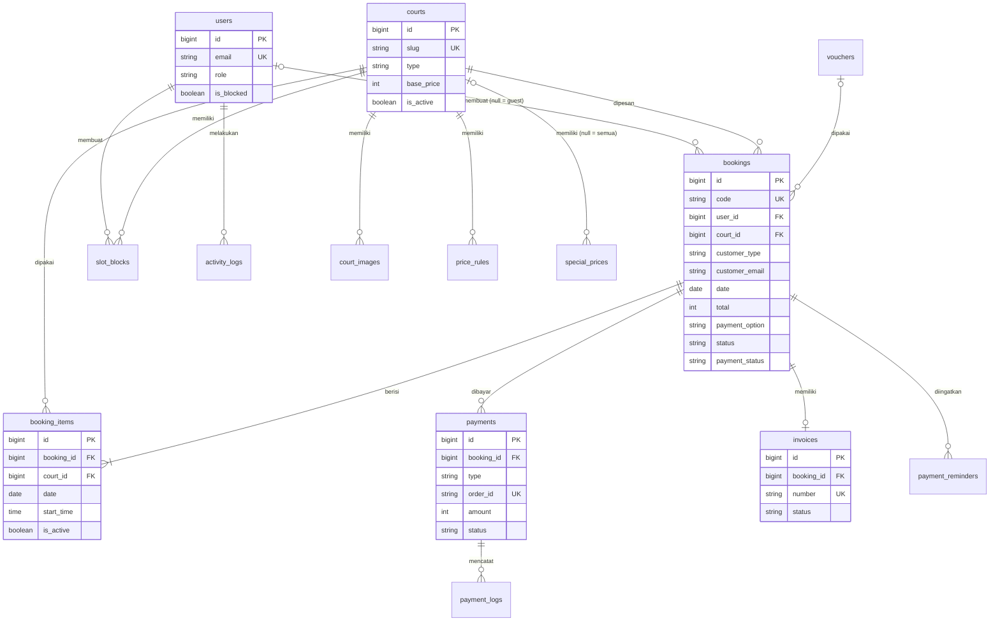

# SCHEMA.md — Database PBS (Paddel Booking System)

Skema database lengkap untuk PBS, diturunkan dari [PRD.md](PRD.md) §10–§12 dan konvensi di [CLAUDE.md](CLAUDE.md).

| Item            | Detail                                                               |
| --------------- | -------------------------------------------------------------------- |
| Versi Skema     | 1.0                                                                  |
| DB              | SQLite (lokal) · MySQL 8 / PostgreSQL 15+ (production)               |
| ORM             | Eloquent (Laravel 12)                                                |
| Zona waktu      | Kolom `timestamp` disimpan UTC (default Laravel), ditampilkan `Asia/Jakarta`; kolom `date` & `time` untuk jadwal main disimpan dalam waktu lokal venue (`Asia/Jakarta`) |

---

## Daftar Isi

1. [Konvensi](#1-konvensi)
2. [ERD](#2-erd)
3. [Enum](#3-enum)
4. [Tabel](#4-tabel)
5. [Relationship Model](#5-relationship-model)
6. [Invariant & Integritas Data](#6-invariant--integritas-data)
7. [Urutan Migrasi](#7-urutan-migrasi)
8. [Seeder](#8-seeder)
9. [Contoh Migrasi](#9-contoh-migrasi)
10. [Contoh Query Penting](#10-contoh-query-penting)

---

## 1. Konvensi

- Nama tabel **snake_case jamak** (`booking_items`), kolom snake_case, primary key `id` (`bigIncrements`).
- Foreign key memakai `foreignId('x_id')->constrained()` dengan aturan hapus eksplisit (lihat tiap tabel).
- **Uang = integer rupiah** (`unsignedInteger`, tanpa desimal). Contoh: `350000`.
- Status disimpan sebagai `string` (bukan `enum` database) dan di-cast ke **PHP Enum** di `app/Enums` — lebih mudah diubah tanpa migrasi & kompatibel di SQLite/MySQL/PostgreSQL.
- Boolean memakai `boolean`; JSON memakai `json` dan di-cast ke `array`.
- Semua tabel bisnis memakai `timestamps()`. `softDeletes()` hanya di `courts` dan `vouchers`.
- Snapshot data pemesan & harga disimpan di booking/invoice agar riwayat tidak berubah saat data master diubah.
- Casts ditulis dengan method `casts()` (gaya Laravel 12), `$fillable` eksplisit.

Legenda kolom: **PK** primary key · **FK** foreign key · **UQ** unique · **IDX** index · **N** nullable.

---

## 2. ERD



---

## 3. Enum

Semua enum adalah **string-backed enum** di `app/Enums`.

| Enum             | Dipakai di                              | Nilai                                                                                   |
| ---------------- | --------------------------------------- | --------------------------------------------------------------------------------------- |
| `UserRole`       | `users.role`                            | `customer`, `staff`, `admin`                                                            |
| `CourtType`      | `courts.type`                           | `indoor`, `outdoor`                                                                     |
| `CustomerType`   | `bookings.customer_type`                | `guest`, `member`                                                                       |
| `BookingSource`  | `bookings.source`                       | `online`, `walk_in`                                                                     |
| `PaymentOption`  | `bookings.payment_option`               | `full`, `dp`                                                                            |
| `BookingStatus`  | `bookings.status`                       | `pending`, `confirmed`, `checked_in`, `completed`, `cancelled`, `expired`, `no_show`    |
| `PaymentStatus`  | `bookings.payment_status`               | `unpaid`, `dp_paid`, `paid`, `refunded`, `partially_refunded`                           |
| `RefundStatus`   | `bookings.refund_status`                | `none`, `requested`, `processed`, `rejected`                                            |
| `PaymentType`    | `payments.type`                         | `full`, `dp`, `settlement`, `offline`                                                   |
| `PaymentProvider`| `payments.provider`                     | `midtrans`, `cash`, `venue_qris`, `bank_transfer`                                       |
| `TransactionStatus` | `payments.status`                    | `pending`, `settlement`, `expired`, `failed`, `refunded`                                |
| `InvoiceStatus`  | `invoices.status`                       | `unpaid`, `partial`, `paid`, `void`                                                     |
| `PriceLabel`     | `price_rules.label`                     | `off_peak`, `peak`, `weekend`, `custom`                                                 |
| `BlockReason`    | `slot_blocks.reason`                    | `maintenance`, `event`, `tournament`, `other`                                           |
| `ReminderType`   | `payment_reminders.type`                | `pending_payment`, `settlement_h1`, `settlement_6h`, `play_h1`, `play_1h`               |
| `ReminderChannel`| `payment_reminders.channel`             | `email`, `whatsapp`                                                                     |
| `VoucherType`    | `vouchers.type` (Fase 2)                | `percent`, `fixed`                                                                      |

### Transisi Status

```
bookings.status
pending ──► confirmed ──► checked_in ──► completed
   │            ├──► cancelled
   │            └──► no_show            (DP belum lunas & tidak hadir)
   ├──► expired                         (tidak bayar dalam 15 menit)
   └──► cancelled

bookings.payment_status
unpaid ──► dp_paid ──► paid
unpaid ──────────────► paid
dp_paid / paid ──► partially_refunded / refunded
```

Kombinasi yang valid:

| `status`      | `payment_status` yang diizinkan                    |
| ------------- | -------------------------------------------------- |
| `pending`     | `unpaid`                                           |
| `confirmed`   | `dp_paid`, `paid`                                  |
| `checked_in`  | `paid`                                             |
| `completed`   | `paid`                                             |
| `no_show`     | `dp_paid`, `paid`                                  |
| `expired`     | `unpaid` (atau `paid` + `refund_status=requested` bila bayar terlambat & slot sudah diambil) |
| `cancelled`   | semua                                              |

---

## 4. Tabel

### 4.1 `users` *(modifikasi tabel bawaan Breeze)*

Migrasi baru `add_pbs_columns_to_users_table`.

| Kolom               | Tipe                 | Atribut                    | Keterangan                                   |
| ------------------- | -------------------- | -------------------------- | -------------------------------------------- |
| id                  | bigIncrements        | PK                         |                                              |
| name                | string(255)          |                            |                                              |
| email               | string(255)          | UQ                         |                                              |
| **phone**           | string(20)           | N, IDX                     | Format `62812xxxx`                            |
| **avatar_path**     | string(255)          | N                          |                                              |
| **role**            | string(20)           | default `customer`, IDX    | `UserRole`                                   |
| **is_blocked**      | boolean              | default `false`            | BR-13                                        |
| **blocked_reason**  | string(255)          | N                          |                                              |
| **dp_suspended_until** | timestamp         | N                          | BR-DP8: akses DP dicabut sampai tanggal ini  |
| **admin_notes**     | text                 | N                          | Catatan internal admin                       |
| email_verified_at   | timestamp            | N                          | Wajib terisi untuk DP & penautan booking guest |
| password            | string(255)          | N                          | Nullable untuk login Google (F2)             |
| **google_id**       | string(255)          | N, UQ                      | Fase 2                                       |
| remember_token      | string(100)          | N                          |                                              |
| created_at / updated_at | timestamps       |                            |                                              |

### 4.2 `courts`

| Kolom        | Tipe             | Atribut                      | Keterangan                                    |
| ------------ | ---------------- | ---------------------------- | --------------------------------------------- |
| id           | bigIncrements    | PK                           |                                               |
| name         | string(100)      |                              | "Court 1 — Panoramic"                         |
| slug         | string(120)      | UQ                           | Route key publik                              |
| type         | string(20)       | IDX                          | `CourtType`                                   |
| surface      | string(50)       | N                            | "Artificial grass", dll.                      |
| description  | text             | N                            |                                               |
| facilities   | json             | N                            | `["lighting","locker","shower"]`              |
| rules        | text             | N                            | Aturan pakai lapangan                         |
| base_price   | unsignedInteger  |                              | Harga dasar per slot (rupiah)                 |
| is_active    | boolean          | default `true`, IDX          | BR-12                                         |
| sort_order   | unsignedSmallInteger | default `0`              |                                               |
| created_at / updated_at | timestamps |                         |                                               |
| deleted_at   | timestamp        | N                            | Soft delete                                   |

### 4.3 `court_images`

| Kolom       | Tipe                 | Atribut                               | Keterangan          |
| ----------- | -------------------- | ------------------------------------- | ------------------- |
| id          | bigIncrements        | PK                                    |                     |
| court_id    | foreignId            | FK → courts, **cascadeOnDelete**      |                     |
| path        | string(255)          |                                       | Path storage        |
| alt         | string(150)          | N                                     | Aksesibilitas       |
| sort_order  | unsignedSmallInteger | default `0`                           | Gambar pertama = cover |
| created_at / updated_at | timestamps |                                     |                     |

IDX: `(court_id, sort_order)`

### 4.4 `price_rules`

| Kolom         | Tipe             | Atribut                           | Keterangan                                   |
| ------------- | ---------------- | --------------------------------- | -------------------------------------------- |
| id            | bigIncrements    | PK                                |                                              |
| court_id      | foreignId        | FK → courts, **cascadeOnDelete**  |                                              |
| label         | string(20)       |                                   | `PriceLabel`                                 |
| days_of_week  | json             |                                   | ISO: `[1,2,3,4,5]` (1 = Senin, 7 = Minggu)   |
| start_time    | time             |                                   | Inklusif                                     |
| end_time      | time             |                                   | Eksklusif                                    |
| price         | unsignedInteger  |                                   | Harga per slot                               |
| is_active     | boolean          | default `true`                    |                                              |
| created_at / updated_at | timestamps |                               |                                              |

IDX: `(court_id, is_active)`
Validasi aplikasi: rentang jam pada hari yang sama untuk satu lapangan **tidak boleh tumpang tindih**.

### 4.5 `special_prices`

| Kolom       | Tipe            | Atribut                                | Keterangan                          |
| ----------- | --------------- | -------------------------------------- | ----------------------------------- |
| id          | bigIncrements   | PK                                     |                                     |
| court_id    | foreignId       | N, FK → courts, **cascadeOnDelete**    | `null` = berlaku semua lapangan     |
| date        | date            | IDX                                    | Mis. libur nasional                 |
| start_time  | time            | N                                      | `null` = seharian                   |
| end_time    | time            | N                                      |                                     |
| price       | unsignedInteger |                                        |                                     |
| note        | string(150)     | N                                      | "Tahun Baru"                        |
| created_at / updated_at | timestamps |                                  |                                     |

IDX: `(date, court_id)`

**Prioritas harga (BR-07):** `special_prices` (court spesifik) → `special_prices` (semua court) → `price_rules` → `courts.base_price`.

### 4.6 `operating_hours`

| Kolom        | Tipe                | Atribut              | Keterangan                        |
| ------------ | ------------------- | -------------------- | --------------------------------- |
| id           | bigIncrements       | PK                   |                                   |
| day_of_week  | unsignedTinyInteger | UQ                   | 1–7 (ISO)                         |
| open_time    | time                | N                    |                                   |
| close_time   | time                | N                    | Boleh `24:00` disimpan `23:59:59` |
| is_closed    | boolean             | default `false`      |                                   |
| created_at / updated_at | timestamps |                   |                                   |

Tanggal tutup khusus (libur venue) disimpan di key `booking.closures` pada tabel `settings` (lihat §4.16).

### 4.7 `slot_blocks`

| Kolom       | Tipe          | Atribut                                  | Keterangan                    |
| ----------- | ------------- | ---------------------------------------- | ----------------------------- |
| id          | bigIncrements | PK                                       |                               |
| court_id    | foreignId     | FK → courts, **cascadeOnDelete**         |                               |
| date        | date          |                                          |                               |
| start_time  | time          |                                          |                               |
| end_time    | time          |                                          |                               |
| reason      | string(20)    |                                          | `BlockReason`                 |
| note        | string(255)   | N                                        |                               |
| created_by  | foreignId     | N, FK → users, **nullOnDelete**          |                               |
| created_at / updated_at | timestamps |                                  |                               |

IDX: `(court_id, date)`
Validasi aplikasi (BR-11): tidak boleh bertabrakan dengan `booking_items` aktif.

### 4.8 `vouchers` *(Fase 2 — tabel dibuat sejak awal agar FK di bookings stabil)*

| Kolom         | Tipe                 | Atribut           | Keterangan                    |
| ------------- | -------------------- | ----------------- | ----------------------------- |
| id            | bigIncrements        | PK                |                               |
| code          | string(30)           | UQ                | Uppercase                     |
| type          | string(10)           |                   | `VoucherType`                 |
| value         | unsignedInteger      |                   | Persen (1–100) atau rupiah    |
| max_discount  | unsignedInteger      | N                 | Batas diskon untuk tipe persen |
| min_amount    | unsignedInteger      | default `0`       |                               |
| quota         | unsignedInteger      | N                 | `null` = tak terbatas          |
| used_count    | unsignedInteger      | default `0`       |                               |
| members_only  | boolean              | default `false`   |                               |
| starts_at     | timestamp            | N                 |                               |
| ends_at       | timestamp            | N                 |                               |
| is_active     | boolean              | default `true`    |                               |
| created_at / updated_at / deleted_at | |                 |                               |

### 4.9 `bookings`

Tabel inti. Data pemesan di-snapshot di `customer_*` untuk guest **dan** member.

| Kolom               | Tipe                 | Atribut                                  | Keterangan                                              |
| ------------------- | -------------------- | ---------------------------------------- | ------------------------------------------------------- |
| id                  | bigIncrements        | PK                                       |                                                         |
| code                | string(12)           | UQ                                       | `PBS-8K2Q7M` (6 karakter acak tanpa 0/O/1/I)            |
| user_id             | foreignId            | N, FK → users, **nullOnDelete**          | `null` = guest (atau akun sudah dihapus)                |
| court_id            | foreignId            | FK → courts, **restrictOnDelete**        | Court memakai soft delete                               |
| voucher_id          | foreignId            | N, FK → vouchers, **nullOnDelete**       | Fase 2                                                  |
| customer_type       | string(10)           |                                          | `CustomerType` — tetap `guest` walau nanti ditautkan    |
| customer_name       | string(100)          |                                          |                                                         |
| customer_email      | string(255)          | IDX                                      | Tujuan link bayar & invoice                             |
| customer_phone      | string(20)           |                                          |                                                         |
| date                | date                 |                                          | Tanggal main                                            |
| start_time          | time                 |                                          | Jam mulai slot pertama                                  |
| end_time            | time                 |                                          | Jam selesai slot terakhir                               |
| players_count       | unsignedTinyInteger  | default `4`                              | 2–4                                                     |
| notes               | text                 | N                                        |                                                         |
| subtotal            | unsignedInteger      |                                          | Σ `booking_items.price`                                 |
| discount            | unsignedInteger      | default `0`                              |                                                         |
| service_fee         | unsignedInteger      | default `0`                              |                                                         |
| total               | unsignedInteger      |                                          | subtotal − discount + service_fee                       |
| payment_option      | string(10)           | default `full`                           | `PaymentOption`                                         |
| dp_percentage       | unsignedTinyInteger  | N                                        | Snapshot dari settings saat booking (mis. 30)           |
| dp_amount           | unsignedInteger      | default `0`                              | 0 jika `full`                                           |
| paid_amount         | unsignedInteger      | default `0`                              | Σ pembayaran `settlement`                               |
| remaining_amount    | unsignedInteger      |                                          | total − paid_amount                                     |
| settlement_due_at   | timestamp            | N                                        | Batas pelunasan DP (BR-DP4)                             |
| status              | string(20)           | default `pending`                        | `BookingStatus`                                         |
| payment_status      | string(20)           | default `unpaid`                         | `PaymentStatus`                                         |
| source              | string(10)           | default `online`                         | `BookingSource`                                         |
| expires_at          | timestamp            | N                                        | Batas bayar hold 15 menit; `null` setelah `confirmed`   |
| confirmed_at        | timestamp            | N                                        |                                                         |
| paid_at             | timestamp            | N                                        | Saat lunas penuh                                        |
| checked_in_at       | timestamp            | N                                        |                                                         |
| checked_in_by       | foreignId            | N, FK → users, **nullOnDelete**          |                                                         |
| cancelled_at        | timestamp            | N                                        |                                                         |
| cancelled_by        | foreignId            | N, FK → users, **nullOnDelete**          |                                                         |
| cancel_reason       | string(255)          | N                                        |                                                         |
| refund_status       | string(20)           | default `none`                           | `RefundStatus`                                          |
| refund_amount       | unsignedInteger      | default `0`                              |                                                         |
| created_by          | foreignId            | N, FK → users, **nullOnDelete**          | Admin/staff untuk booking walk-in                       |
| ip_address          | string(45)           | N                                        | Rate limit guest (BR-G5)                                |
| anonymized_at       | timestamp            | N                                        | Data guest dianonimkan (UU PDP)                         |
| created_at / updated_at | timestamps       |                                          |                                                         |

Index:
- UQ `code`
- IDX `(date, court_id, status)` — kalender & jadwal
- IDX `(user_id, status)` — My Bookings
- IDX `customer_email` — penautan guest & Cek Booking
- IDX `(status, expires_at)` — scheduler expire
- IDX `(payment_status, settlement_due_at)` — piutang & pengingat
- IDX `(ip_address, created_at)` — rate limit guest

### 4.10 `booking_items`

Satu baris per slot. **Kunci anti double booking.**

| Kolom       | Tipe            | Atribut                                  | Keterangan                                              |
| ----------- | --------------- | ---------------------------------------- | ------------------------------------------------------- |
| id          | bigIncrements   | PK                                       |                                                         |
| booking_id  | foreignId       | FK → bookings, **cascadeOnDelete**       |                                                         |
| court_id    | foreignId       | FK → courts, **restrictOnDelete**        | Denormalisasi untuk unique index                        |
| date        | date            |                                          |                                                         |
| start_time  | time            |                                          | Harus sejajar grid slot (durasi dari settings)          |
| end_time    | time            |                                          |                                                         |
| price       | unsignedInteger |                                          | Snapshot harga slot (BR-08)                             |
| price_label | string(20)      | N                                        | Snapshot `PriceLabel` untuk laporan peak/off-peak       |
| is_active   | boolean         | N, default `true`                        | `true` saat booking `pending/confirmed/checked_in/completed/no_show`; **`null`** saat `cancelled/expired` |
| created_at / updated_at | timestamps |                                  |                                                         |

Index:
- **UQ `(court_id, date, start_time, is_active)`** — `NULL` dianggap berbeda di MySQL, PostgreSQL, dan SQLite, sehingga slot yang dibatalkan bisa dipesan ulang.
- IDX `booking_id`

> Penting: jangan pernah mengisi `is_active = false`. Nilai non-aktif **wajib `null`**, jika tidak unique index akan memblokir pembatalan kedua pada slot yang sama.

### 4.11 `payments`

Satu baris per **percobaan** pembayaran (FULL / DP / SETTLE / OFFLINE).

| Kolom           | Tipe            | Atribut                                  | Keterangan                                              |
| --------------- | --------------- | ---------------------------------------- | ------------------------------------------------------- |
| id              | bigIncrements   | PK                                       |                                                         |
| booking_id      | foreignId       | FK → bookings, **restrictOnDelete**      |                                                         |
| type            | string(20)      |                                          | `PaymentType`                                           |
| provider        | string(20)      | default `midtrans`                       | `PaymentProvider`                                       |
| order_id        | string(50)      | UQ                                       | `PBS-8K2Q7M-DP-1`; offline: `PBS-8K2Q7M-OFF-1`           |
| amount          | unsignedInteger |                                          | Gross amount                                            |
| status          | string(20)      | default `pending`                        | `TransactionStatus`                                     |
| snap_token      | string(100)     | N                                        |                                                         |
| snap_redirect_url | string(255)   | N                                        |                                                         |
| transaction_id  | string(100)     | N, IDX                                   | ID dari Midtrans                                        |
| payment_method  | string(50)      | N                                        | `qris`, `gopay`, `bca_va`, `credit_card`, `cash`        |
| fraud_status    | string(20)      | N                                        | Midtrans `accept`/`challenge`/`deny`                    |
| paid_at         | timestamp       | N                                        |                                                         |
| expires_at      | timestamp       | N                                        |                                                         |
| recorded_by     | foreignId       | N, FK → users, **nullOnDelete**          | Staff/admin untuk pembayaran offline                    |
| raw_response    | json            | N                                        | Respons status terakhir                                 |
| created_at / updated_at | timestamps |                                     |                                                         |

Index: UQ `order_id` · IDX `(booking_id, status)` · IDX `(status, created_at)`

### 4.12 `payment_logs`

Append-only, tanpa `updated_at`.

| Kolom       | Tipe          | Atribut                               | Keterangan                                        |
| ----------- | ------------- | ------------------------------------- | ------------------------------------------------- |
| id          | bigIncrements | PK                                    |                                                   |
| payment_id  | foreignId     | N, FK → payments, **cascadeOnDelete** | `null` jika webhook dengan order_id tak dikenal   |
| order_id    | string(50)    | IDX                                   |                                                   |
| event       | string(30)    |                                       | `snap_created`, `notification`, `status_check`, `cancel_request`, `signature_invalid` |
| payload     | json          |                                       |                                                   |
| created_at  | timestamp     | useCurrent                            |                                                   |

### 4.13 `invoices`

Satu invoice per booking; diperbarui setiap ada pembayaran.

| Kolom            | Tipe            | Atribut                               | Keterangan                                   |
| ---------------- | --------------- | ------------------------------------- | -------------------------------------------- |
| id               | bigIncrements   | PK                                    |                                              |
| booking_id       | foreignId       | UQ, FK → bookings, **restrictOnDelete** |                                            |
| number           | string(30)      | UQ                                    | `INV/PBS/2026/09/000123`                     |
| status           | string(10)      | default `unpaid`                      | `InvoiceStatus`                              |
| billed_name      | string(100)     |                                       | Snapshot                                     |
| billed_email     | string(255)     |                                       | Snapshot                                     |
| billed_phone     | string(20)      |                                       | Snapshot                                     |
| subtotal         | unsignedInteger |                                       |                                              |
| discount         | unsignedInteger | default `0`                           |                                              |
| service_fee      | unsignedInteger | default `0`                           |                                              |
| total            | unsignedInteger |                                       |                                              |
| paid_amount      | unsignedInteger | default `0`                           |                                              |
| remaining_amount | unsignedInteger |                                       |                                              |
| issued_at        | timestamp       |                                       |                                              |
| paid_at          | timestamp       | N                                     |                                              |
| pdf_path         | string(255)     | N                                     | Dibuat ulang saat status berubah             |
| last_sent_at     | timestamp       | N                                     |                                              |
| created_at / updated_at | timestamps |                                   |                                              |

Nomor invoice dibuat di dalam transaksi: ambil nomor urut terakhir bulan berjalan dengan `lockForUpdate()`, lalu +1.

### 4.14 `payment_reminders`

| Kolom       | Tipe          | Atribut                                | Keterangan          |
| ----------- | ------------- | -------------------------------------- | ------------------- |
| id          | bigIncrements | PK                                     |                     |
| booking_id  | foreignId     | FK → bookings, **cascadeOnDelete**     |                     |
| type        | string(20)    |                                        | `ReminderType`      |
| channel     | string(10)    | default `email`                        | `ReminderChannel`   |
| sent_at     | timestamp     |                                        |                     |
| created_at / updated_at | timestamps |                                |                     |

UQ `(booking_id, type, channel)` — mencegah pengingat terkirim ganda.

### 4.15 `activity_logs`

| Kolom         | Tipe          | Atribut                           | Keterangan                                          |
| ------------- | ------------- | --------------------------------- | --------------------------------------------------- |
| id            | bigIncrements | PK                                |                                                     |
| user_id       | foreignId     | N, FK → users, **nullOnDelete**   | `null` = sistem/scheduler                           |
| action        | string(50)    | IDX                               | `court.price_updated`, `booking.cancelled`, `customer.blocked`, `payment.offline_recorded` |
| subject_type  | string(255)   | N                                 | `nullableMorphs('subject')`                         |
| subject_id    | bigint        | N                                 |                                                     |
| properties    | json          | N                                 | `{ "old": {...}, "new": {...} }`                    |
| ip_address    | string(45)    | N                                 |                                                     |
| created_at    | timestamp     | useCurrent                        |                                                     |

IDX `(subject_type, subject_id)` · IDX `(user_id, created_at)`

### 4.16 `settings`

Key-value; di-cache (`Cache::rememberForever('settings')`) dan di-flush saat diubah.

| Kolom      | Tipe          | Atribut | Keterangan |
| ---------- | ------------- | ------- | ---------- |
| key        | string(100)   | PK      |            |
| value      | json          | N       |            |
| updated_at | timestamp     | N       |            |

Key default:

| Key                              | Default                  | Keterangan                              |
| -------------------------------- | ------------------------ | --------------------------------------- |
| `venue.name`                     | `"PBS Padel Club"`       |                                         |
| `venue.address`                  | `""`                     |                                         |
| `venue.coordinates`              | `{"lat":null,"lng":null}`|                                         |
| `venue.whatsapp`                 | `""`                     |                                         |
| `venue.socials`                  | `{}`                     |                                         |
| `booking.slot_duration_minutes`  | `60`                     | BR-01                                   |
| `booking.max_slots_per_booking`  | `3`                      | BR-02                                   |
| `booking.advance_days`           | `14`                     | BR-03                                   |
| `booking.hold_minutes`           | `15`                     | BR-05                                   |
| `booking.max_pending_per_user`   | `2`                      | BR-06                                   |
| `booking.cancel_before_hours`    | `24`                     | BR-09                                   |
| `booking.service_fee`            | `0`                      |                                         |
| `booking.closures`               | `[]`                     | Tanggal venue tutup `["2026-12-25"]`    |
| `guest.enabled`                  | `true`                   |                                         |
| `guest.max_bookings_per_ip_hour` | `3`                      | BR-G5                                   |
| `dp.enabled`                     | `true`                   |                                         |
| `dp.percentage`                  | `30`                     | BR-DP2                                  |
| `dp.min_days_ahead`              | `1`                      | BR-DP3                                  |
| `dp.settle_before_hours`         | `3`                      | BR-DP4                                  |
| `dp.no_show_grace_minutes`       | `15`                     | BR-DP6                                  |
| `dp.max_unsettled_per_user`      | `2`                      | BR-DP7                                  |
| `dp.refundable_before_hours`     | `24`                     |                                         |
| `invoice.company_name`           | `""`                     |                                         |
| `invoice.tax_id`                 | `null`                   | NPWP                                    |
| `invoice.footer_note`            | `""`                     |                                         |
| `home.hero`                      | `{"headline":"Own The Court.","subheadline":""}` |                 |

### 4.17 `testimonials`

| Kolom        | Tipe                 | Atribut           |
| ------------ | -------------------- | ----------------- |
| id           | bigIncrements        | PK                |
| name         | string(100)          |                   |
| role         | string(100)          | N                 |
| content      | text                 |                   |
| rating       | unsignedTinyInteger  | default `5`       |
| avatar_path  | string(255)          | N                 |
| is_published | boolean              | default `true`    |
| sort_order   | unsignedSmallInteger | default `0`       |
| created_at / updated_at | timestamps |                 |

### 4.18 `faqs`

| Kolom        | Tipe                 | Atribut           |
| ------------ | -------------------- | ----------------- |
| id           | bigIncrements        | PK                |
| question     | string(255)          |                   |
| answer       | text                 |                   |
| show_on_home | boolean              | default `false`   |
| is_published | boolean              | default `true`    |
| sort_order   | unsignedSmallInteger | default `0`       |
| created_at / updated_at | timestamps |                 |

### 4.19 Tabel Bawaan Laravel (tidak diubah)

`password_reset_tokens`, `sessions`, `cache`, `cache_locks`, `jobs`, `job_batches`, `failed_jobs`.

---

## 5. Relationship Model

Sesuai CLAUDE.md: relasi didefinisikan eksplisit dengan return type; controller memanggil model langsung.

| Model             | Method                         | Tipe                                         | Catatan                                   |
| ----------------- | ------------------------------ | -------------------------------------------- | ----------------------------------------- |
| `User`            | `bookings()`                   | `HasMany(Booking)`                           |                                           |
|                   | `payments()`                   | `HasManyThrough(Payment, Booking)`           |                                           |
|                   | `invoices()`                   | `HasManyThrough(Invoice, Booking)`           |                                           |
|                   | `activityLogs()`               | `HasMany(ActivityLog)`                       |                                           |
| `Court`           | `images()`                     | `HasMany(CourtImage)`                        | `->orderBy('sort_order')`                 |
|                   | `coverImage()`                 | `HasOne(CourtImage)`                         | `->oldestOfMany('sort_order')`            |
|                   | `priceRules()`                 | `HasMany(PriceRule)`                         |                                           |
|                   | `specialPrices()`              | `HasMany(SpecialPrice)`                      |                                           |
|                   | `slotBlocks()`                 | `HasMany(SlotBlock)`                         |                                           |
|                   | `bookings()`                   | `HasMany(Booking)`                           |                                           |
|                   | `bookingItems()`               | `HasMany(BookingItem)`                       |                                           |
| `CourtImage`      | `court()`                      | `BelongsTo(Court)`                           |                                           |
| `PriceRule`       | `court()`                      | `BelongsTo(Court)`                           |                                           |
| `SpecialPrice`    | `court()`                      | `BelongsTo(Court)`                           | nullable                                  |
| `SlotBlock`       | `court()`                      | `BelongsTo(Court)`                           |                                           |
|                   | `creator()`                    | `BelongsTo(User, 'created_by')`              |                                           |
| `Booking`         | `user()`                       | `BelongsTo(User)`                            | nullable (guest)                          |
|                   | `court()`                      | `BelongsTo(Court)`                           | `->withTrashed()`                         |
|                   | `voucher()`                    | `BelongsTo(Voucher)`                         |                                           |
|                   | `items()`                      | `HasMany(BookingItem)`                       | `->orderBy('start_time')`                 |
|                   | `payments()`                   | `HasMany(Payment)`                           |                                           |
|                   | `latestPayment()`              | `HasOne(Payment)`                            | `->latestOfMany()`                        |
|                   | `invoice()`                    | `HasOne(Invoice)`                            |                                           |
|                   | `reminders()`                  | `HasMany(PaymentReminder)`                   |                                           |
|                   | `checkedInBy()`                | `BelongsTo(User, 'checked_in_by')`           |                                           |
|                   | `cancelledBy()`                | `BelongsTo(User, 'cancelled_by')`            |                                           |
|                   | `createdBy()`                  | `BelongsTo(User, 'created_by')`              |                                           |
| `BookingItem`     | `booking()`                    | `BelongsTo(Booking)`                         |                                           |
|                   | `court()`                      | `BelongsTo(Court)`                           |                                           |
| `Payment`         | `booking()`                    | `BelongsTo(Booking)`                         |                                           |
|                   | `logs()`                       | `HasMany(PaymentLog)`                        |                                           |
|                   | `recordedBy()`                 | `BelongsTo(User, 'recorded_by')`             |                                           |
| `PaymentLog`      | `payment()`                    | `BelongsTo(Payment)`                         |                                           |
| `Invoice`         | `booking()`                    | `BelongsTo(Booking)`                         |                                           |
| `PaymentReminder` | `booking()`                    | `BelongsTo(Booking)`                         |                                           |
| `Voucher`         | `bookings()`                   | `HasMany(Booking)`                           |                                           |
| `ActivityLog`     | `user()`                       | `BelongsTo(User)`                            |                                           |
|                   | `subject()`                    | `MorphTo`                                    |                                           |

### Scope & Helper di Model

| Model     | Scope / Method                                   | Fungsi                                                      |
| --------- | ------------------------------------------------ | ----------------------------------------------------------- |
| `Court`   | `scopeActive()`                                  | `is_active = true`                                          |
|           | `priceAt(CarbonInterface $date, string $time): int` | Prioritas harga BR-07                                    |
|           | `priceLabelAt(...)`                              | Label peak/off-peak untuk snapshot                          |
| `Booking` | `scopeUpcoming()` / `scopePast()`                | Berdasarkan `date` + `start_time`                           |
|           | `scopeActive()`                                  | `pending`, `confirmed`, `checked_in`                        |
|           | `scopeExpirable()`                               | `pending` & `expires_at < now()`                            |
|           | `scopeUnsettled()`                               | `payment_status = dp_paid`                                  |
|           | `scopeForEmail(string $email)`                   | Penautan guest & Cek Booking                                |
|           | `isGuest(): bool` · `canPayDp(): bool` · `canBeCancelled(): bool` |                                            |
|           | `calculateDpAmount(): int`                       | `ceil(total × dp% / 100 / 1000) × 1000`                     |
|           | `recalculatePaidAmount(): void`                  | Σ payments settlement → `paid_amount`, `remaining_amount`, `payment_status` |
|           | `releaseSlots(): void`                           | Set `booking_items.is_active = null`                        |
|           | `static generateCode(): string`                  |                                                             |
| `BookingItem` | `scopeActiveOn(int $courtId, string $date)`  | Slot terpakai untuk availability                            |
| `Payment` | `scopeSettled()`                                 | `status = settlement`                                       |
| `User`    | `isAdmin()` · `isStaff()` · `canUseDp(): bool`   | Cek role, verifikasi email, blokir, `dp_suspended_until`    |
|           | `scopeCustomers()`                               | `role = customer`                                           |

### Casts

| Model          | Casts                                                                                                        |
| -------------- | ------------------------------------------------------------------------------------------------------------ |
| `User`         | `role → UserRole`, `is_blocked → boolean`, `email_verified_at`, `dp_suspended_until → datetime`, `password → hashed` |
| `Court`        | `type → CourtType`, `facilities → array`, `is_active → boolean`                                              |
| `PriceRule`    | `label → PriceLabel`, `days_of_week → array`, `is_active → boolean`                                          |
| `SpecialPrice` | `date → date`                                                                                                |
| `SlotBlock`    | `date → date`, `reason → BlockReason`                                                                        |
| `Booking`      | `date → date`, `customer_type → CustomerType`, `payment_option → PaymentOption`, `status → BookingStatus`, `payment_status → PaymentStatus`, `refund_status → RefundStatus`, `source → BookingSource`, semua kolom `*_at → datetime` |
| `BookingItem`  | `date → date`, `is_active → boolean`                                                                         |
| `Payment`      | `type → PaymentType`, `provider → PaymentProvider`, `status → TransactionStatus`, `raw_response → array`, `paid_at`, `expires_at → datetime` |
| `PaymentLog`   | `payload → array`                                                                                            |
| `Invoice`      | `status → InvoiceStatus`, `issued_at`, `paid_at`, `last_sent_at → datetime`                                  |
| `Setting`      | `value → array`                                                                                              |
| `ActivityLog`  | `properties → array`                                                                                         |

---

## 6. Invariant & Integritas Data

| #   | Invariant                                                                                           | Ditegakkan oleh                             |
| --- | --------------------------------------------------------------------------------------------------- | ------------------------------------------- |
| I-1 | Tidak ada dua slot aktif pada `court_id + date + start_time` yang sama                              | **Unique index** `booking_items` + transaction lock |
| I-2 | `bookings.total = subtotal − discount + service_fee`                                                | Model saat create (server-side)             |
| I-3 | `bookings.paid_amount = Σ payments.amount` dengan `status = settlement`                             | `Booking::recalculatePaidAmount()` di webhook |
| I-4 | `remaining_amount = total − paid_amount` (tidak negatif)                                            | idem                                        |
| I-5 | `customer_type = guest` ⇒ `payment_option = full`                                                   | Validasi controller (BR-G2)                 |
| I-6 | `payment_option = dp` ⇒ `dp_amount > 0` dan `settlement_due_at` terisi                              | Controller checkout                         |
| I-7 | `payments.order_id` unik secara global                                                              | Unique index                                |
| I-8 | Status booking ↔ payment_status mengikuti tabel kombinasi §3                                        | Webhook & scheduler                         |
| I-9 | `booking_items.is_active` hanya `true` atau `null`                                                  | `Booking::releaseSlots()`                   |
| I-10| Satu booking maksimal satu invoice                                                                  | Unique index `invoices.booking_id`          |
| I-11| Satu pengingat per (booking, type, channel)                                                         | Unique index `payment_reminders`            |

### Aturan Hapus (onDelete)

| Relasi                          | Aturan         | Alasan                                                  |
| ------------------------------- | -------------- | ------------------------------------------------------- |
| users → bookings                | nullOnDelete   | Riwayat transaksi tetap ada (data pemesan di snapshot)  |
| courts → bookings/booking_items | restrict       | Court memakai soft delete                               |
| courts → images/price_rules/blocks | cascade     | Data turunan court                                      |
| bookings → booking_items/reminders | cascade     | Booking praktis tidak pernah dihapus fisik              |
| bookings → payments/invoices    | restrict       | Data keuangan tidak boleh hilang                        |
| payments → payment_logs         | cascade        |                                                         |

---

## 7. Urutan Migrasi

```
0001_01_01_000000_create_users_table.php            (bawaan)
0001_01_01_000001_create_cache_table.php            (bawaan)
0001_01_01_000002_create_jobs_table.php             (bawaan)
2026_09_15_000001_add_pbs_columns_to_users_table.php
2026_09_15_000002_create_courts_table.php
2026_09_15_000003_create_court_images_table.php
2026_09_15_000004_create_price_rules_table.php
2026_09_15_000005_create_special_prices_table.php
2026_09_15_000006_create_operating_hours_table.php
2026_09_15_000007_create_slot_blocks_table.php
2026_09_15_000008_create_vouchers_table.php
2026_09_15_000009_create_bookings_table.php
2026_09_15_000010_create_booking_items_table.php
2026_09_15_000011_create_payments_table.php
2026_09_15_000012_create_payment_logs_table.php
2026_09_15_000013_create_invoices_table.php
2026_09_15_000014_create_payment_reminders_table.php
2026_09_15_000015_create_settings_table.php
2026_09_15_000016_create_testimonials_table.php
2026_09_15_000017_create_faqs_table.php
2026_09_15_000018_create_activity_logs_table.php
```

---

## 8. Seeder

| Seeder                   | Isi                                                                                      | Environment      |
| ------------------------ | ---------------------------------------------------------------------------------------- | ---------------- |
| `UserSeeder`             | 1 admin (`admin@pbs.test`), 1 staff (`staff@pbs.test`), password dari `.env` / `password` | semua            |
| `SettingSeeder`          | Semua key default §4.16                                                                  | semua            |
| `OperatingHourSeeder`    | Senin–Minggu 06:00–23:00                                                                 | semua            |
| `CourtSeeder`            | 4 lapangan (2 indoor, 2 outdoor) + gambar placeholder                                    | semua            |
| `PriceRuleSeeder`        | Weekday 06–16 Rp250.000 (off_peak), Weekday 16–23 Rp350.000 (peak), Weekend Rp400.000     | semua            |
| `FaqSeeder`              | 8 FAQ (4 tampil di homepage)                                                             | semua            |
| `TestimonialSeeder`      | 6 testimoni                                                                              | lokal/staging    |
| `DemoBookingSeeder`      | 50 customer (factory), ±300 booking 60 hari ke belakang & 14 hari ke depan dengan campuran guest/member, full/DP, berbagai status — untuk mengisi dashboard | lokal/staging |

Factory yang dibutuhkan: `UserFactory` (sudah ada, tambah state `admin()`, `staff()`), `CourtFactory`, `BookingFactory` (state `guest()`, `member()`, `dp()`, `paid()`, `expired()`), `BookingItemFactory`, `PaymentFactory`.

---

## 9. Contoh Migrasi

### `bookings`

```php
Schema::create('bookings', function (Blueprint $table) {
    $table->id();
    $table->string('code', 12)->unique();
    $table->foreignId('user_id')->nullable()->constrained()->nullOnDelete();
    $table->foreignId('court_id')->constrained()->restrictOnDelete();
    $table->foreignId('voucher_id')->nullable()->constrained()->nullOnDelete();

    $table->string('customer_type', 10);
    $table->string('customer_name', 100);
    $table->string('customer_email')->index();
    $table->string('customer_phone', 20);

    $table->date('date');
    $table->time('start_time');
    $table->time('end_time');
    $table->unsignedTinyInteger('players_count')->default(4);
    $table->text('notes')->nullable();

    $table->unsignedInteger('subtotal');
    $table->unsignedInteger('discount')->default(0);
    $table->unsignedInteger('service_fee')->default(0);
    $table->unsignedInteger('total');

    $table->string('payment_option', 10)->default('full');
    $table->unsignedTinyInteger('dp_percentage')->nullable();
    $table->unsignedInteger('dp_amount')->default(0);
    $table->unsignedInteger('paid_amount')->default(0);
    $table->unsignedInteger('remaining_amount');
    $table->timestamp('settlement_due_at')->nullable();

    $table->string('status', 20)->default('pending');
    $table->string('payment_status', 20)->default('unpaid');
    $table->string('source', 10)->default('online');

    $table->timestamp('expires_at')->nullable();
    $table->timestamp('confirmed_at')->nullable();
    $table->timestamp('paid_at')->nullable();
    $table->timestamp('checked_in_at')->nullable();
    $table->foreignId('checked_in_by')->nullable()->constrained('users')->nullOnDelete();
    $table->timestamp('cancelled_at')->nullable();
    $table->foreignId('cancelled_by')->nullable()->constrained('users')->nullOnDelete();
    $table->string('cancel_reason')->nullable();
    $table->string('refund_status', 20)->default('none');
    $table->unsignedInteger('refund_amount')->default(0);
    $table->foreignId('created_by')->nullable()->constrained('users')->nullOnDelete();
    $table->string('ip_address', 45)->nullable();
    $table->timestamp('anonymized_at')->nullable();
    $table->timestamps();

    $table->index(['date', 'court_id', 'status']);
    $table->index(['user_id', 'status']);
    $table->index(['status', 'expires_at']);
    $table->index(['payment_status', 'settlement_due_at']);
    $table->index(['ip_address', 'created_at']);
});
```

### `booking_items`

```php
Schema::create('booking_items', function (Blueprint $table) {
    $table->id();
    $table->foreignId('booking_id')->constrained()->cascadeOnDelete();
    $table->foreignId('court_id')->constrained()->restrictOnDelete();
    $table->date('date');
    $table->time('start_time');
    $table->time('end_time');
    $table->unsignedInteger('price');
    $table->string('price_label', 20)->nullable();
    $table->boolean('is_active')->nullable()->default(true);
    $table->timestamps();

    // Anti double booking: slot non-aktif bernilai NULL sehingga tidak bentrok
    $table->unique(['court_id', 'date', 'start_time', 'is_active'], 'booking_items_slot_unique');
});
```

---

## 10. Contoh Query Penting

Ditulis langsung di controller sesuai CLAUDE.md.

**Ketersediaan slot (Availability API)**

```php
$court = Court::active()->findOrFail($request->court_id);

$booked = BookingItem::query()
    ->where('court_id', $court->id)
    ->whereDate('date', $request->date)
    ->where('is_active', true)
    ->with('booking:id,status')
    ->get(['booking_id', 'start_time']);

$blocks = $court->slotBlocks()->whereDate('date', $request->date)->get();
```

**Membuat booking (dengan lock)**

```php
$booking = DB::transaction(function () use ($court, $slots, $validated, $request) {
    $taken = BookingItem::query()
        ->where('court_id', $court->id)
        ->whereDate('date', $validated['date'])
        ->whereIn('start_time', $slots)
        ->where('is_active', true)
        ->lockForUpdate()
        ->exists();

    abort_if($taken, 409, 'Slot baru saja dipesan orang lain.');

    $booking = Booking::create([...]);
    $booking->items()->createMany($items); // unique index tetap jadi pengaman terakhir

    return $booking;
});
```

**Scheduler expire booking**

```php
Booking::expirable()->each(function (Booking $booking) {
    DB::transaction(function () use ($booking) {
        $booking->update(['status' => BookingStatus::Expired, 'expires_at' => null]);
        $booking->releaseSlots();
    });
});
```

**Dashboard: pendapatan & piutang**

```php
$revenue = Payment::settled()
    ->whereBetween('paid_at', [$from, $to])
    ->sum('amount');

$receivables = Booking::unsettled()
    ->where('status', BookingStatus::Confirmed)
    ->sum('remaining_amount');

$occupancyHeatmap = BookingItem::query()
    ->where('is_active', true)
    ->whereBetween('date', [$from, $to])
    ->selectRaw('start_time, COUNT(*) as total')  // hari dihitung di PHP agar kompatibel lintas DB
    ->addSelect('date')
    ->groupBy('date', 'start_time')
    ->get();
```

**Menautkan booking guest setelah email diverifikasi**

```php
Booking::forEmail($user->email)
    ->whereNull('user_id')
    ->update(['user_id' => $user->id]);
```
